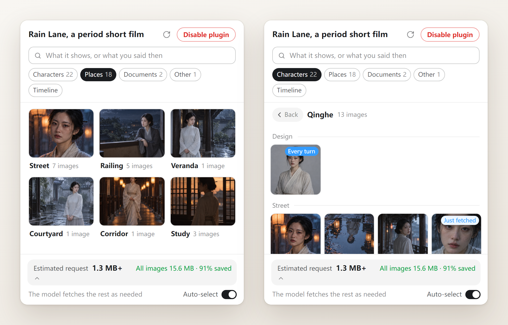

<p align="center">
  
</p>

<h1 align="center">Context Attachment Manager</h1>

<p align="center"><b>Keep long, image-heavy chats in Codex and Claude Code fast.</b><br>Earlier images become one-line placeholders with an ID. When the model needs one again, it fetches the original by its ID, also after the chat is compacted.</p>

<p align="center">
  <a href="https://github.com/chipfighter/context-attachment-manager/releases"></a>
  
  <a href="LICENSE"></a>
</p>

<p align="center"><b>English</b> · <a href="README_CN.md">简体中文</a> · <a href="README_JA.md">日本語</a> · <a href="README_KO.md">한국어</a> · <a href="README_ES.md">Español</a> · <a href="README_PT_BR.md">Português (Brasil)</a> · <a href="README_FR.md">Français</a> · <a href="README_DE.md">Deutsch</a></p>

<p align="center">
  <picture>
    <source media="(prefers-color-scheme: dark)" srcset="docs/images/hero-dark.gif">
    
  </picture>
</p>

<table>
  <tr>
    <td align="center" width="33%"><h3>42.4 MB → 0.12 MB</h3>One request in a Codex chat<br>with nine keyframes</td>
    <td align="center" width="33%"><h3>20/20 vs 8/20</h3>Questions about the images<br>after compaction (Sonnet 5.5)</td>
    <td align="center" width="33%"><h3>About the same cost</h3>Largest request: 41,859<br>vs 110,671 tokens</td>
  </tr>
</table>

## Get started in three steps

**1. Install.** Send this to your agent. It identifies its platform and installs the right setup:

```text
Install Context Attachment Manager for me, following https://github.com/chipfighter/context-attachment-manager/blob/main/INSTALL.md
```

Then restart the agent (in Claude Desktop, start a new Code session). To do it by hand, see [installation, updates and uninstall](INSTALL.md).

**2. Work as usual.** The plugin is on by default. Images from earlier turns go out as one-line placeholders; new images and the references you pin go out as they are. A placeholder looks like this:

```text
[Image IMG-004 omitted | shot-1.png | generated image | turn 2 | 505×505]
Features: place: Street | Qinghe | medium shot, umbrella, lanterns
For the original, call cam_view_image with "IMG-004".
```

**3. The model fetches by ID.** When it needs to look at an earlier image again, it fetches the original by its ID, also after compaction. Nothing is deleted, and your images and chat history stay on your computer.

## The panel: browse by character and place

<p align="center">
  <picture>
    <source media="(prefers-color-scheme: dark)" srcset="docs/images/panel-dark.png">
    
  </picture>
</p>

The plugin works without the panel; open it when you want control:

- **Browse by character and place**: images are sorted into characters, places, screens and documents, with one card per name. Open a character to see their design images first, then the shots they appear in, place by place.
- **Find an image** by a detail or a comment you remember, like "rainy night" or "best face".
- **Keep a reference in view**: open an image and check **Send every turn**.
- **Choose images yourself**: turn off **Auto-select** and pick what goes with your next message.

In **Codex**, open **Context Assets** in the task's side panel. In **Claude Desktop's Code tab**, the panel opens automatically when there are images; type `/cam` to bring it back.

## Results

- **Codex**: a chat with nine keyframes grew to 42.4 MB and could not be sent after a restart or a compaction; with the plugin the same requests were 0.12 MB.
- **Claude Code (Sonnet 5.5)**: in a 16-turn short-film task whose images exist only in the conversation, we compacted the chat and then asked about the images. With the plugin it answered 20 of 20 questions correctly; without it, 8 of 20. Its largest request was 41,859 tokens instead of 110,671, at about the same cost.

See the [Codex comparison](eval/README.md), the [Claude Code compaction comparison](eval/compaction/README.md) and the [Claude Code long-task comparison](eval/long-task/README.md) for the results and reproduction steps.

## How it works: keep the cache working

Model services cache the start of a chat. When a request begins exactly like the one before, that part is read from the cache, which is faster and much cheaper. When something early in the chat changes, everything after the change is processed again. The plugin makes its change as late in the chat as it can:

<p align="center">
  
</p>

- **A placeholder is written once**: an image becomes a placeholder in the turn after it appeared, and stays the same from request to request.
- **Fetching changes nothing earlier**: the original is added at the end of the current turn and its placeholder stays where it is, so earlier turns are still read from the cache.
- **The model gets the original back**: not a smaller copy, and not a summary of it.

<details>
<summary>How fetching works, and what it costs</summary>

<p align="center">
  
</p>

This is not free. After a turn with images, the rest of that turn is processed again once, and the model writes a short line for each new image. Changing an old image in the panel (unchecking it, checking it again, **Send every turn**) changes the chat at that image, so what follows it is processed again once. In our [long-task comparison in Claude Code](eval/long-task/README.md), 87% of the input was read from the cache with the plugin and 91% without it.

An agent's own compaction, and clearing old tool results on the API side (Anthropic's context editing, for example), remove early content so that what follows is processed again: the third row of the first figure.

</details>

## Works with

Codex and Claude Code are tested, and Codex and Claude Desktop also have the panel. The other agents below are supported through adapters written from their code and docs, but we have not tested them live yet. If you use one of them, please [tell us how it went](https://github.com/chipfighter/context-attachment-manager/issues), whether it worked or not.

| Agent | What it is | Support |
|---|---|---|
| [Codex](https://github.com/openai/codex) | OpenAI's coding agent, desktop and CLI | Auto-select + panel, tested |
| [Claude Code](https://github.com/anthropics/claude-code) | Anthropic's coding agent, desktop and CLI | Auto-select + panel (desktop), tested |
| [WorkBuddy](https://www.workbuddy.cn) | Tencent's desktop AI work assistant, with CodeBuddy inside | Auto-select, not tested yet |
| [OpenCode](https://github.com/anomalyco/opencode) | Open-source terminal coding agent for any model provider | Auto-select, not tested yet |
| [Gemini CLI](https://github.com/google-gemini/gemini-cli) | Google's open-source terminal agent | Auto-select, not tested yet |
| [pi](https://github.com/earendil-works/pi) | Minimal, extensible terminal coding agent | Auto-select (pi extension), not tested yet |
| [DeepSeek Harness](https://github.com/deepseek-ai/deepseek-harness) | DeepSeek's agent harness where everything is a plugin | Auto-select (dsh plugin), not tested yet |
| [Qwen Code](https://github.com/QwenLM/qwen-code) | Qwen's open-source terminal agent | Auto-select, not tested yet |
| [Cline](https://github.com/cline/cline) | Open-source coding agent for VS Code, JetBrains and the terminal | Auto-select, not tested yet |
| [Kilo Code](https://github.com/Kilo-Org/kilocode) | Open-source coding agent for VS Code, JetBrains and the terminal | Auto-select, not tested yet |
| [goose](https://github.com/aaif-goose/goose) | Open-source agent for desktop and terminal, extended with MCP | Auto-select, not tested yet |
| [Cherry Studio](https://github.com/CherryHQ/cherry-studio) | Open-source desktop chat client for many models | Auto-select, not tested yet |

Setup for these agents: [INSTALL.md](INSTALL.md#other-agents). To connect another agent, see [ADAPTERS.md](ADAPTERS.md).

## FAQ

### Why do Codex and Claude Code get slow in a long chat with many images?

The agent sends every earlier image again with each message, so a long chat with many images gets slow and can stop going through. In Codex, a chat with nine keyframes grew to 42.4 MB and could not be sent after a restart or a compaction; with Context Attachment Manager the same requests were 0.12 MB.

### Does Context Attachment Manager break the prompt cache?

Only a little. A placeholder is written once and then stays the same, and a fetched image is added at the end of the current turn, so earlier turns are still read from the cache. After a turn with images, the rest of that turn is processed again once. In our long-task comparison in Claude Code, 87% of the input was read from the cache with the plugin and 91% without it.

### How is it different from compaction, or from shrinking the images?

Compaction and dropping early history remove the early part of the chat, and shrinking the images changes it. Either way nearly the whole chat is processed again, and the model is left with a summary or a smaller copy. With Context Attachment Manager, only the rest of the previous turn is processed again, and the model gets the original image back by its ID.

### Does the model still know the earlier images after compaction?

Yes. Every image has an ID such as `IMG-001`, and the model notes one line on each: its category, a name, and the characters in it. These stay in the placeholders after compaction, and the model fetches the original by its ID when it needs to look again.

### Does it handle the many screenshots of computer use and browser use?

Yes. When tools return many screenshots in one turn, the older ones become placeholders in batches and the newest few go out as they are. The model can note a run of similar screenshots in one line and fetch any of them back by its ID.

### Are my images deleted, or sent anywhere else?

No. The plugin runs on your computer. Your original images and chat history stay as they are, and requests go to the service your agent already uses.

### Which agents does it work with, and is it free?

Codex and Claude Code are tested. WorkBuddy, OpenCode, Gemini CLI, pi, DeepSeek Harness, Qwen Code, Cline, Kilo Code, goose and Cherry Studio are supported through adapters that we have not tested live yet. It is free and open source under the MIT license.

### How do I install it? Do I need a terminal?

No. Send your agent the one sentence in [Get started](#get-started-in-three-steps) above: it identifies its platform and runs the setup itself, and you only restart the agent afterwards (in Claude Desktop, start a new Code session). In Codex you can also install it from the Plugins page with a few clicks. If you prefer to do it by hand, it takes one command in Codex and two `claude` commands in Claude Desktop; see [INSTALL.md](INSTALL.md).

<p align="center"><sub><a href="CHANGELOG.md">Changelog</a> · <a href="CONTRIBUTING.md">Contributing</a> · <a href="LICENSE">MIT License</a></sub></p>
