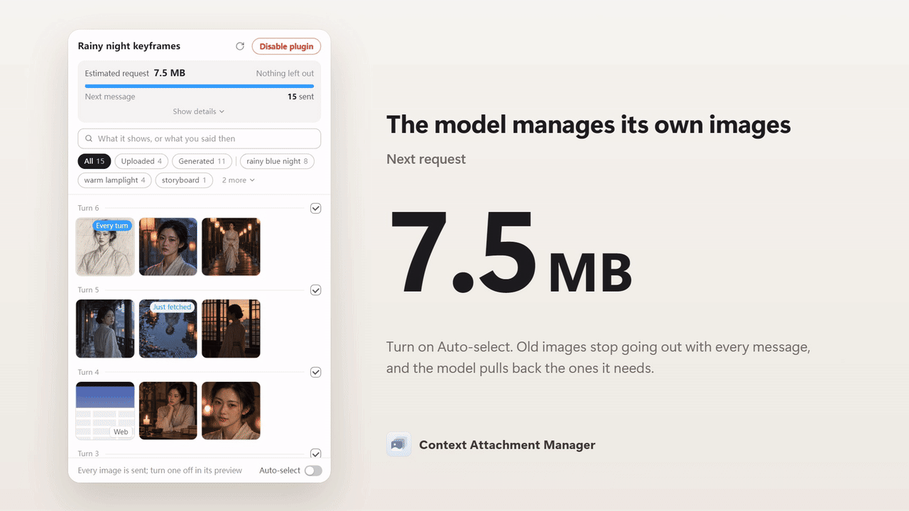
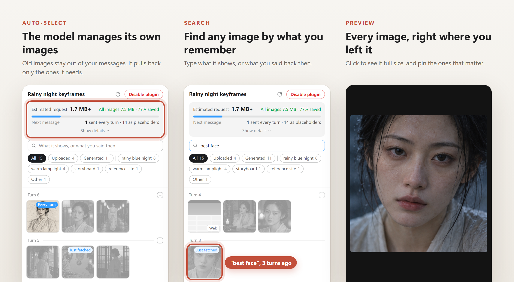

<p align="center">
  
</p>

<h1 align="center">Context Attachment Manager</h1>

<p align="center"><b>Long image chats in Codex and Claude, without the lag.</b><br>The model manages its own images, pulling back only what it needs. And any image you made before is one search away: just describe what you remember.</p>

<p align="center">
  <a href="https://github.com/chipfighter/context-attachment-manager/actions/workflows/ci.yml"></a>
  <a href="https://github.com/chipfighter/context-attachment-manager/releases"></a>
  
  
  
  <a href="LICENSE"></a>
</p>

<p align="center"><b>English</b> · <a href="README_CN.md">简体中文</a></p>

<p align="center">
  
</p>

<p align="center">
  
</p>

## Why I made this

I was iterating on images with GPT in Codex. After a dozen or so, the chat started failing: it kept reconnecting and never got through. Every message was sending every image in the conversation again, about 44 MB each time. The only way out was a new chat, and with it, losing everything we had built up.

So I made a panel that keeps the conversation and drops the weight.

## What it does

- **The model manages its own images.** Earlier images stay out of your messages, and when the model needs one, it pulls that one back by itself. Nothing to set up. Pin the ones that matter, like a character reference, and they go with every message.
- **Find any image by what you remember.** Search "best face" or "rainy night", filter by place, or browse by turn. Click one to see it full size.
- **It remembers every image.** The model quietly notes what each image shows and what you said about it ("too dark", "best face"). Even far into a long chat, or after the chat is compacted, it picks the right one.
- **Your chat stays light.** No more slowdowns or endless reconnecting. In a 15-image task, a request that carried 24.9 MB went out at 212 KB.

## How to use

- **Codex**: open **Context Assets** in a task's side panel.
- **Claude Desktop**: in the Code tab, the panel opens by itself next to your conversation once there are images. Type `/cam` to bring it back.

Then just keep chatting. From the start, the model picks earlier images on its own; to pin one, click it and check **Send every turn**. To choose yourself, turn off **Auto-select** at the bottom of the panel.

## Install

Paste this to Codex, or to Claude in Claude Desktop's Code tab:

```text
Install the Context Attachment Manager plugin for me, following https://github.com/chipfighter/context-attachment-manager/blob/main/INSTALL.md
```

Then restart Codex, or start a new session in Claude. To install or uninstall it yourself, see [INSTALL.md](INSTALL.md).

## Privacy

Everything stays on your computer. The plugin sends nothing anywhere beyond the requests Codex and Claude already make.

<p align="center"><sub><a href="CHANGELOG.md">Changelog</a> · <a href="CONTRIBUTING.md">Contributing</a> · <a href="LICENSE">MIT License</a></sub></p>
