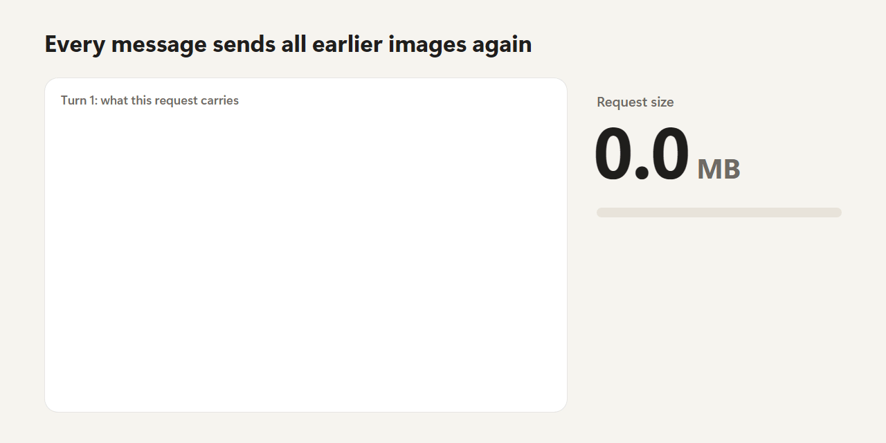

<div dir="rtl">

<p align="center">
  
</p>

<h1 align="center">Context Attachment Manager</h1>

<p align="center"><b>حافظ على سرعة المحادثات الطويلة المليئة بالصور في Codex وClaude Code.</b><br>تُستبدل كل صورة من الجولات السابقة بسطر قصير يحمل معرّفًا. عندما يحتاج النموذج إلى رؤيتها مجددًا، يسترجع الصورة الأصلية بهذا المعرّف، حتى بعد اختصار سجل المحادثة.</p>

<p align="center">
  <a href="https://github.com/chipfighter/context-attachment-manager/releases"></a>
  
  <a href="LICENSE"></a>
</p>

<p align="center" dir="ltr">
  <a href="README.md">English</a> · <a href="README_CN.md">简体中文</a> · <a href="README_TW.md">繁體中文</a> · <a href="README_JA.md">日本語</a> · <a href="README_KO.md">한국어</a> · <a href="README_VI.md">Tiếng Việt</a><br>
  <a href="README_ES.md">Español</a> · <a href="README_PT_BR.md">Português (Brasil)</a> · <a href="README_FR.md">Français</a> · <a href="README_DE.md">Deutsch</a> · <a href="README_IT.md">Italiano</a> · <a href="README_PL.md">Polski</a><br>
  <a href="README_RU.md">Русский</a> · <a href="README_TR.md">Türkçe</a> · <b>العربية</b> · <a href="README_HI.md">हिन्दी</a> · <a href="README_ID.md">Bahasa Indonesia</a> · <a href="README_TH.md">ไทย</a>
</p>

<p align="center">
  <picture>
    <source media="(prefers-color-scheme: dark)" srcset="docs/images/hero-dark.gif">
    
  </picture>
</p>

<table>
  <tr>
    <td align="center" width="33%"><h3 dir="ltr">42.4 MB → 0.12 MB</h3>حجم طلب واحد في محادثة Codex فيها تسعة إطارات رئيسية</td>
    <td align="center" width="33%"><h3 dir="ltr">20/20 مقابل 8/20</h3>الإجابات الصحيحة عن الصور بعد اختصار السجل (Sonnet 5.5)</td>
    <td align="center" width="33%"><h3>تكلفة متقاربة</h3>أكبر طلب احتوى على 41,859 بدلًا من 110,671 رمزًا</td>
  </tr>
</table>

## البدء في ثلاث خطوات

**1. ثبّت الإضافة.** أرسل الجملة التالية إلى وكيلك. سيتعرّف على منصته ويتبع خطوات التثبيت المناسبة.

```text
ثبّت لي Context Attachment Manager باتباع هذا الدليل: https://github.com/chipfighter/context-attachment-manager/blob/main/INSTALL.md
```

بعد ذلك أعد تشغيل الوكيل. في Claude Desktop، ابدأ جلسة Code جديدة. للتثبيت اليدوي، راجع [دليل التثبيت والتحديث والإزالة](INSTALL.md) بالإنجليزية. في Codex وClaude Code تُثبّت الإصدارات الجديدة في الخلفية وتعمل عند إعادة التشغيل.

**2. واصل عملك كالمعتاد.** الإضافة مفعّلة افتراضيًا. تحل سطور تحمل المعرّفات محل الصور القديمة، بينما تُرسل الصور الجديدة والمراجع المثبّتة كاملة.

```text
[Image IMG-004 omitted | shot-1.png | generated image | turn 2 | 505×505]
Features: place: Street | Qinghe | medium shot, umbrella, lanterns
For the original, call cam_view_image with "IMG-004".
```

**3. يسترجع النموذج الأصل بالمعرّف.** عندما يحتاج إلى مراجعة صورة سابقة، يمكنه استرجاعها حتى بعد اختصار المحادثة. تبقى الصور الأصلية وسجل المحادثة على جهازك.

## لوحة لتصفّح الصور بحسب الشخصية والمكان

<p align="center">
  <picture>
    <source media="(prefers-color-scheme: dark)" srcset="docs/images/panel-dark.png">
    
  </picture>
</p>

- **تصفّح بحسب الفئة.** تُجمع الصور في بطاقات للشخصيات والأماكن والشاشات والمستندات. تظهر الصور المرجعية أولًا في بطاقة الشخصية، ثم اللقطات التي تظهر فيها الشخصية مرتبة حسب المكان.
- **ابحث بتفصيل أو تعليق تتذكّره.** اكتب مثلًا «ليلة ممطرة» أو «أفضل لقطة للوجه».
- **ثبّت صورة مرجعية.** افتح الصورة واختر **Send every turn**.
- **اختر الصور بنفسك.** أوقف **Auto-select** وحدّد الصور التي تريد إرسالها مع الرسالة التالية.

في Codex افتح **Context Assets** من الشريط الجانبي للمهمة. وفي تبويب Code في Claude Desktop تُفتح اللوحة تلقائيًا عند وجود صور. اكتب `/cam` لفتحها مجددًا. تعمل الإضافة أيضًا عندما تكون اللوحة مغلقة.

## نتائج الاختبارات

- **Codex.** في محادثة Codex تضم تسعة إطارات رئيسية، بلغ حجم الطلب 42.4 ميغابايت وتعذّر إرساله بعد إعادة التشغيل أو اختصار السجل. مع الإضافة، أُرسل الطلب نفسه بحجم 0.12 ميغابايت.
- **Claude Code (Sonnet 5.5).** في مهمة لإعداد فيلم قصير امتدت 16 جولة، أجاب Sonnet 5.5 بعد اختصار السجل عن 20 من أصل 20 سؤالًا حول صور لا توجد إلا في المحادثة. من دون الإضافة أجاب عن 8 من أصل 20. انخفض أكبر طلب من 110,671 إلى 41,859 رمزًا، بتكلفة متقاربة.

تجد النتائج وخطوات إعادة الاختبار في [مقارنة Codex](eval/README.md) و[اختبار اختصار السجل في Claude Code](eval/compaction/README.md) و[اختبار المهمة الطويلة في Claude Code](eval/long-task/README.md).

## كيف تستمر الاستفادة من التخزين المؤقت؟

يمكن لخدمة النموذج قراءة بداية المحادثة من ذاكرة التخزين المؤقت ما دامت ثابتة. عند تغيير جزء سابق تُعاد معالجة ما يليه. تُجري الإضافة تغييراتها في أقرب نقطة ممكنة إلى نهاية المحادثة.

<p align="center">
  
</p>

يُكتب سطر المعرّف في الجولة التي تلي ظهور الصورة ويبقى ثابتًا. عند طلب الأصل يُضاف إلى نهاية الجولة الحالية، ويبقى سطره السابق في مكانه.

بعد جولة فيها صور، تُعاد معالجة ما تبقّى من تلك الجولة مرة واحدة، ويكتب النموذج وصفًا موجزًا لكل صورة جديدة. إذا غيّرت اختيار صورة قديمة من اللوحة، تُعاد معالجة ما يليها مرة واحدة. في [اختبار المهمة الطويلة](eval/long-task/README.md)، قُرئ 87% من المدخلات من ذاكرة التخزين المؤقت مع الإضافة، و91% من دونها.

## الوكلاء المدعومون

اختبرنا Codex وClaude Code. اللوحة متاحة في تطبيقَي Codex وClaude لسطح المكتب. تدعم بقية الوكلاء الاختيار التلقائي عبر موصّلات لم نختبرها بعد في تشغيل فعلي.

[Codex](https://github.com/openai/codex) · [Claude Code](https://github.com/anthropics/claude-code) · [WorkBuddy](https://www.workbuddy.cn) · [OpenCode](https://github.com/anomalyco/opencode) · [Gemini CLI](https://github.com/google-gemini/gemini-cli) · [pi](https://github.com/earendil-works/pi) · [DeepSeek Harness](https://github.com/deepseek-ai/deepseek-harness) · [Qwen Code](https://github.com/QwenLM/qwen-code) · [Cline](https://github.com/cline/cline) · [Kilo Code](https://github.com/Kilo-Org/kilocode) · [goose](https://github.com/aaif-goose/goose) · [Cherry Studio](https://github.com/CherryHQ/cherry-studio)

راجع [INSTALL.md](INSTALL.md#other-agents) للإعداد. إذا جرّبت أحد هذه الموصّلات، [أخبرنا بالنتيجة](https://github.com/chipfighter/context-attachment-manager/issues). لإضافة وكيل آخر، راجع [ADAPTERS.md](ADAPTERS.md).

## أسئلة شائعة

### لماذا تتباطأ المحادثة الطويلة عند تراكم الصور؟

يمكن أن تعيد كل رسالة جديدة إرسال الصور السابقة كلها. يكبر الطلب مع تراكم الصور وقد يتعذّر إرساله.

### ما الفرق بين الإضافة واختصار السجل أو تصغير الصور؟

يغيّر اختصار السجل الجزء السابق من المحادثة، أما التصغير فيغيّر الصورة نفسها. تترك الإضافة سطرًا ثابتًا يمكن استخدامه لاسترجاع الصورة الأصلية.

### هل يمكن العثور على صور سابقة بعد اختصار السجل؟

نعم. لكل صورة معرّف مثل `IMG-001` ووصف موجز يضم فئتها واسمها والشخصيات فيها. يستطيع النموذج استرجاع الأصل بالمعرّف.

### ماذا يحدث إذا عادت عشرات لقطات الشاشة في جولة واحدة؟

تُستبدل اللقطات الأقدم بسطور تحمل المعرّفات على دفعات، بينما تُرسل أحدث اللقطات كاملة. يمكن للنموذج وصف اللقطات المتشابهة في سطر واحد واسترجاع أي لقطة بمعرّفها.

### هل تعمل الإضافة مع ملفات PDF؟

في Claude Code، عند تفعيل **Auto-select** يُستبدل ملف PDF المقروء سابقًا بسطر يحمل معرّفًا مثل `PDF-001`. يسترجع النموذج الصفحات المطلوبة فقط بالمعرّف ورقم الصفحة. تعمل هذه الميزة مع ملفات PDF النصية والممسوحة ضوئيًا. في Codex تُدار الصفحات المحوّلة إلى صور مثل أي صورة أخرى.

### أين تذهب صوري وطلباتي؟

تبقى الصور الأصلية والسجل على جهازك. تذهب الطلبات إلى الخدمة نفسها التي يستخدمها وكيلك. لا يتضمّن فحص التحديثات على GitHub معلومات عنك، ويمكن إيقافه من اللوحة.

### هل أحتاج إلى الطرفية؟ وهل الإضافة مجانية؟

يمكنك طلب التثبيت من وكيلك أو استخدام صفحة Plugins في Codex. للتثبيت اليدوي، راجع [INSTALL.md](INSTALL.md). الإضافة مجانية ومفتوحة المصدر بترخيص MIT.

<p align="center"><sub><a href="CHANGELOG.md">سجل التغييرات</a> · <a href="CONTRIBUTING.md">المساهمة في المشروع</a> · <a href="LICENSE">ترخيص MIT</a></sub></p>

</div>
