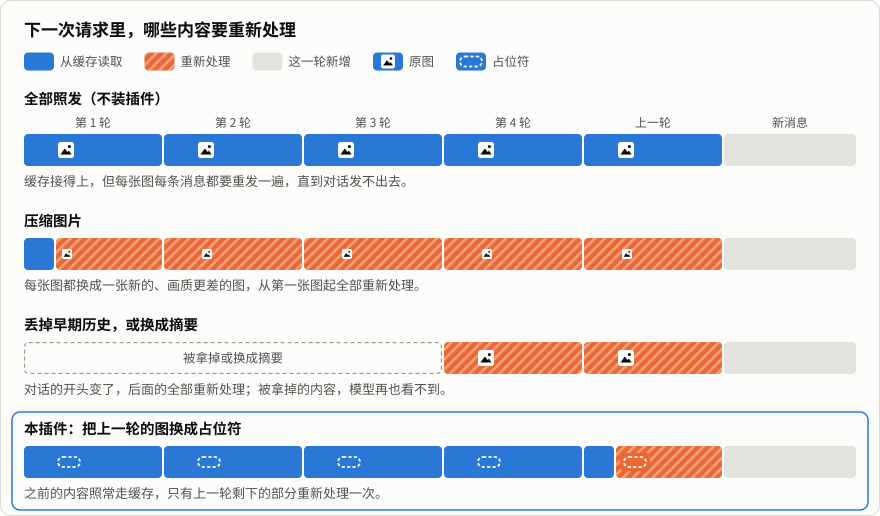
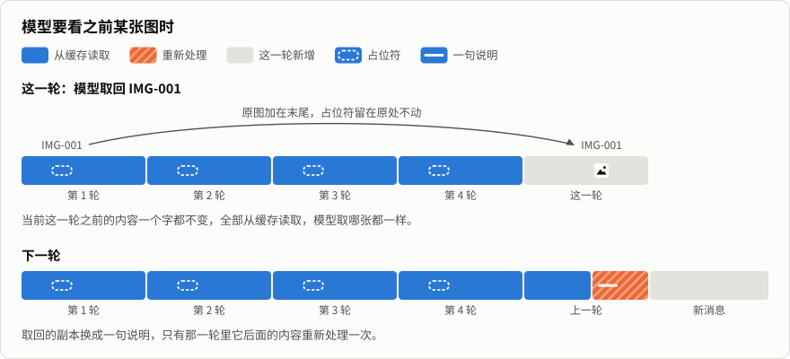

<p align="center">
  
</p>

<h1 align="center">Context Attachment Manager</h1>

<p align="center"><b>Codex、Claude Code 等 Agent 多图对话的本地插件。</b><br>之前的图不再每条消息都重发一遍。模型要看哪张，按编号取回，对话压缩之后也一样。</p>

<p align="center">
  <a href="https://github.com/chipfighter/context-attachment-manager/releases"></a>
  
  <a href="LICENSE"></a>
</p>

<p align="center"><a href="README.md">English</a> · <b>简体中文</b> · <a href="README_JA.md">日本語</a> · <a href="README_KO.md">한국어</a> · <a href="README_ES.md">Español</a> · <a href="README_PT_BR.md">Português (Brasil)</a> · <a href="README_FR.md">Français</a> · <a href="README_DE.md">Deutsch</a></p>

<p align="center">
  
</p>

## 它做什么

Agent 每发一条消息，通常会把之前所有的图再发一遍，图一多，对话就越来越慢，最后可能发不出去。这个插件给每张图编号（`IMG-001`、`IMG-002`……），之前的图改成发一段简短的占位：

- **模型要哪张取哪张**：需要再看之前的某张图时，按编号取回原图。
- **认得出是哪张**：模型给每张图记一行看得见的特征，也记下你对它的评价；这些写在占位里，对话压缩之后也还在。
- **尽量不打断缓存**：占位符只写一次，之后不再变，之前的对话照常从模型服务的缓存（prompt cache）读取。见[设计](#设计尽量不打断缓存)。
- **什么都不删**：原始图片和对话记录保持原样。

默认开着，不用打开面板。常见用法：图片和视频创作、扫描文档、电脑和浏览器操作。

## 安装

把这句话发给你的 Agent，它会认出自己所在的平台，完成对应的安装：

```text
帮我安装 Context Attachment Manager 插件，按这里的说明来：https://github.com/chipfighter/context-attachment-manager/blob/main/INSTALL.md
```

装好后重启 Agent（Claude 桌面版是新建一个 Code 会话）。查看[支持的平台](#支持的平台)，或阅读[安装、更新和卸载说明](INSTALL.md)（英文）。

## 想自己掌控时，打开面板

<p align="center">
  
</p>

- **凭印象找图**：搜“雨夜”或“脸最好”，按记得的特征和评价找回来。
- **固定重要参考**：点开图片，勾上**每轮都发**。
- **自己选择图片**：关掉**自动选图**，决定下一条消息带哪些图。

**Codex**：在任务的侧边面板里打开**上下文素材**。**Claude 桌面版的 Code 标签页**：有了图，面板就会自动打开；输入 `/cam` 可以再打开。

## 隐私

插件在本机运行。原始图片和对话记录保留在你的电脑上，请求仍发给 Agent 原本使用的服务。

## 效果测试

在 Codex 里，一段有九张关键帧的对话涨到 42.4 MB，重启或压缩之后发不出去；装上插件，同样的请求是 0.12 MB。结果和复现步骤见 [Codex 对比评测](eval/README_CN.md)与 [Claude Code 长任务评测](eval/long-task/README_CN.md)。

## 设计：尽量不打断缓存

模型服务会缓存对话的开头：一次请求的开头和上一次完全相同时，这部分从缓存读取，更快，也便宜得多。对话靠前的内容一变，从改动的地方往后都要重新处理。

想让长对话变小，总要改动点什么。这个插件把改动放在尽量靠后的地方：

<p align="center">
  
</p>

- **占位符只写一次**：图片在它出现的下一轮换成占位符，只有那一轮剩下的内容重新处理一次。之后每次请求里，占位符都是同样的文字。
- **取图不动前面的内容**：原图加在当前这一轮的末尾，占位符留在原处。不管对话里有多少张图、模型取哪一张，当前这一轮之前的内容都照常从缓存读取。
- **拿回来的是原图**：不是缩小的副本，也不是一段摘要。

<p align="center">
  
</p>

这不是没有代价：有图的一轮结束后，那一轮剩下的内容要重新处理一次，模型还要给每张新图写一行特征。在面板里改一张旧图的设置（取消、勾回、**每轮都发**），对话在那张图的位置变了，后面的内容也要重新处理一次。在 [Claude Code 长任务评测](eval/long-task/README_CN.md)里，装插件时 87% 的输入从缓存读取，不装是 91%。

第一张图的第三行，也是 Agent 自带的压缩和 API 侧清理旧工具结果（例如 Anthropic 的 context editing）的做法：靠前的内容被拿掉，后面的重新处理。

## 支持的平台

Codex 和 Claude Code 已实测，Codex 和 Claude 桌面版还有面板。下面其他平台也支持，接入是照各平台的代码和文档写的，但我们还没有实际测过。如果你在用其中某个，欢迎[告诉我们用起来怎么样](https://github.com/chipfighter/context-attachment-manager/issues)，能用和不能用都有帮助。

| 平台 | 简介 | 接入情况 |
|---|---|---|
| [Codex](https://github.com/openai/codex) | OpenAI 的编程智能体，桌面版和命令行 | 自动选图＋面板，已实测 |
| [Claude Code](https://github.com/anthropics/claude-code) | Anthropic 的编程智能体，桌面版和命令行 | 自动选图＋面板（桌面版），已实测 |
| [WorkBuddy](https://www.workbuddy.cn) | 腾讯的桌面 AI 工作助手，内置 CodeBuddy | 自动选图，未实测 |
| [OpenCode](https://github.com/anomalyco/opencode) | 开源的终端编程智能体，能接任意模型服务 | 自动选图，未实测 |
| [Gemini CLI](https://github.com/google-gemini/gemini-cli) | Google 开源的终端智能体 | 自动选图，未实测 |
| [pi](https://github.com/earendil-works/pi) | 极简、可扩展的终端编程智能体 | 自动选图（pi 扩展），未实测 |
| [DeepSeek Harness](https://github.com/deepseek-ai/deepseek-harness) | DeepSeek 的智能体框架，一切皆插件 | 自动选图（dsh 插件），未实测 |
| [Qwen Code](https://github.com/QwenLM/qwen-code) | 通义千问开源的终端智能体 | 自动选图，未实测 |
| [Cline](https://github.com/cline/cline) | 开源的编程智能体，VS Code、JetBrains 和终端都能用 | 自动选图，未实测 |
| [Kilo Code](https://github.com/Kilo-Org/kilocode) | 开源的编程智能体，VS Code、JetBrains 和终端都能用 | 自动选图，未实测 |
| [goose](https://github.com/aaif-goose/goose) | 开源的桌面和终端智能体，用 MCP 扩展 | 自动选图，未实测 |
| [Cherry Studio](https://github.com/CherryHQ/cherry-studio) | 开源的桌面 AI 聊天客户端，能接多家模型 | 自动选图，未实测 |

这些平台的安装步骤见 [INSTALL.md](INSTALL.md#other-agents)（英文）。想接入别的 Agent，见[接入说明](ADAPTERS.md)（英文）。

## 常见问题

### 为什么 Codex、Claude Code 的对话图一多就变慢？

Agent 每发一条消息，通常会把之前所有的图再发一遍，图一多，对话就越来越慢，最后可能发不出去。在 Codex 里，一段有九张关键帧的对话涨到 42.4 MB，重启或压缩之后发不出去；装上 Context Attachment Manager，同样的请求是 0.12 MB。

### 用了 Context Attachment Manager，提示缓存（prompt cache）会失效吗？

影响很小。占位符只写一次，之后不再变；取回的原图加在当前这一轮的末尾，所以之前各轮照常从缓存读取。有图的一轮结束后，那一轮剩下的内容要重新处理一次。在 Claude Code 长任务评测里，装插件时 87% 的输入从缓存读取，不装是 91%。

### 它和对话压缩、压缩图片有什么不同？

对话压缩和丢掉早期历史会拿掉对话靠前的内容，压缩图片会改动这些内容。两种做法下，几乎整段对话都要重新处理，模型手里只剩摘要或缩小的副本。用 Context Attachment Manager，只有上一轮剩下的部分重新处理，模型按编号取回的是原图。

### 模型还能看到之前的图吗？

能。每张图都有编号，比如 `IMG-001`，模型需要再看时按编号取回原图，对话压缩之后也一样。

### 我的图片会被删除，或者发到别的地方吗？

不会。插件在本机运行，原始图片和对话记录保持原样，请求仍发给 Agent 原本使用的服务。

### 支持哪些平台？收费吗？

Codex 和 Claude Code 已实测。WorkBuddy、OpenCode、Gemini CLI、pi、DeepSeek Harness、Qwen Code、Cline、Kilo Code、goose、Cherry Studio 也支持，接入是照各平台的代码和文档写的，还没有实际测过。项目开源，使用 MIT 许可证，不收费。

<p align="center"><sub><a href="CHANGELOG.md">更新记录</a> · <a href="CONTRIBUTING.md">参与开发</a> · <a href="LICENSE">MIT 许可证</a></sub></p>
