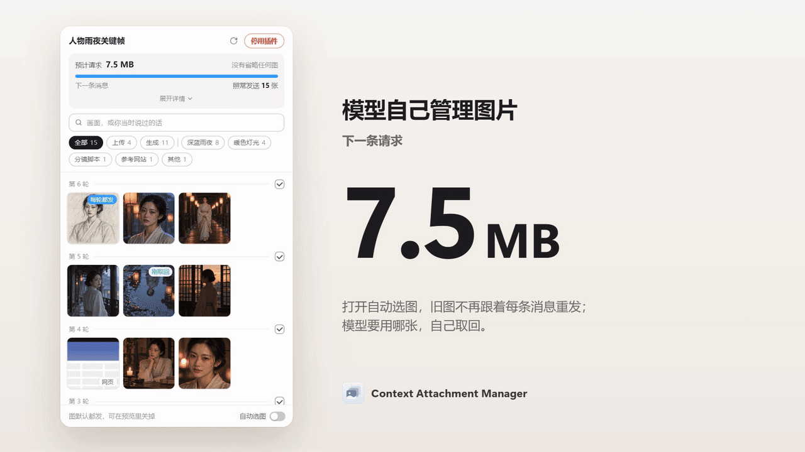
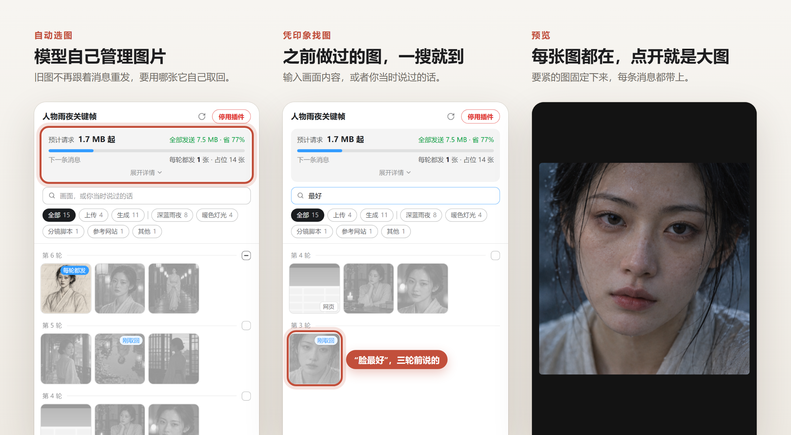

<p align="center">
  
</p>

<h1 align="center">Context Attachment Manager</h1>

<p align="center"><b>在 Codex 和 Claude 里跟 AI 改图，聊再久也不卡。</b><br>模型自己管理图片，用到哪张取哪张；之前做过的图，凭印象一搜就到。</p>

<p align="center">
  <a href="https://github.com/chipfighter/context-attachment-manager/actions/workflows/ci.yml"></a>
  <a href="https://github.com/chipfighter/context-attachment-manager/releases"></a>
  
  
  
  <a href="LICENSE"></a>
</p>

<p align="center"><a href="README.md">English</a> · <b>简体中文</b></p>

<p align="center">
  
</p>

<p align="center">
  
</p>

## 为什么做这个

我在 Codex 里用 GPT 反复生图、改图。图攒到十几张以后，对话开始出问题：一直在重连，怎么都发不出去。原来每发一条消息，对话里所有的图都要重新上传一遍，一次就是约 44 MB。唯一的办法是新开对话，前面攒下的东西也就全没了。

所以我做了这个面板：对话留着，负担卸掉。

## 能做什么

- **模型自己管理图片。** 之前的图不再跟着每条消息重发，要用哪张，模型自己把那一张取回来，什么都不用设置。要紧的图，比如角色参考图，可以固定成每条消息都带上。
- **凭印象找图。** 搜“脸最好”或者“雨夜”，按地点筛选，或者按轮翻看，点开就是大图。
- **每张图它都记得。** 模型会悄悄记下每张图画的是什么，以及你对它说过什么（“太暗”“这张脸最好”）。聊得再久，对话压缩过，它照样拿对图。
- **对话一直轻快。** 不再越聊越慢、反复重连。一个 15 张图的任务里，原本 24.9 MB 的请求，发出去只有 212 KB。

## 怎么用

- **Codex**：在任务的侧边面板里打开**上下文素材**。
- **Claude 桌面版**：在 Code 标签页里，对话里有了图，面板就自己在对话旁边打开。输入 `/cam` 可以随时再打开。

然后照常聊天就行。一开始，模型就会自己挑之前的图；想固定某张，点开它，勾上**每轮都发**。想自己选，就关掉面板底部的**自动选图**。

## 安装

把这句话发给 Codex，或者 Claude 桌面版 Code 标签页里的 Claude：

```text
帮我安装 Context Attachment Manager 插件，按这里的说明来：https://github.com/chipfighter/context-attachment-manager/blob/main/INSTALL.md
```

装好后重启 Codex，或者在 Claude 里新建一个会话。想自己动手安装或卸载，看 [INSTALL.md](INSTALL.md)（英文）。

## 隐私

所有东西都留在你自己的电脑上。除了 Codex 和 Claude 本来就要发的请求，插件不往任何地方发数据。

<p align="center"><sub><a href="CHANGELOG.md">更新记录</a> · <a href="CONTRIBUTING.md">参与开发</a> · <a href="LICENSE">MIT 许可证</a></sub></p>
