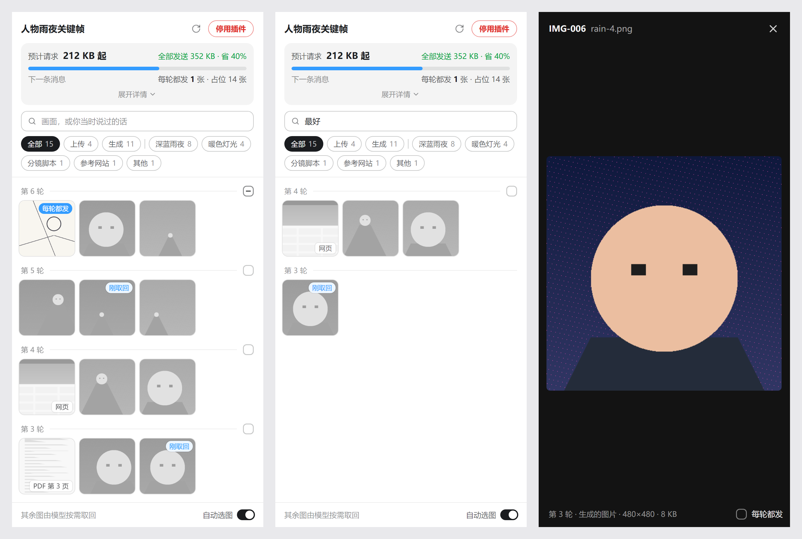

<p align="center">
  
</p>

<h1 align="center">Context Attachment Manager</h1>

<p align="center">在 Codex 和 Claude 桌面版里，不换对话，决定哪些历史图片随下一条消息发给模型。</p>

<p align="center">
  <a href="https://github.com/chipfighter/context-attachment-manager/actions/workflows/ci.yml"></a>
  <a href="https://github.com/chipfighter/context-attachment-manager/releases"></a>
  
  
  
  <a href="LICENSE"></a>
</p>

<p align="center"><a href="README.md">English</a> · <b>简体中文</b></p>

> **0.8 新增：模型给每张图记笔记，面板里凭印象就能找到图。** 模型在你看不到的行里，记下每张新图画的是什么，以及你对它的评价（“太暗”“脸最好”）。占位文字带着这些笔记，所以压缩对话之后，模型照样能拿对图。面板也重做了：按画面或你当时说过的话搜索，按场景筛选，按轮浏览缩略图，点开的图占满整个面板。**之前的版本：** 0.7 起 Codex 的子代理和旁聊也按自动选图来，0.6 起默认开启自动选图、Claude 桌面版里面板自己打开，0.5 起 Claude Code 压缩对话后勾选照样有效，0.4 起 Claude 桌面版也能用。项目原名 *Codex Attachment Manager*，因为不再只给 Codex 用，改了名。

<p align="center">
  
</p>
<p align="center"><sub>开发页上的合成任务：按轮分组的图、按你说过的话搜索，以及预览。</sub></p>

## 为什么做这个

我在 Codex 里用 GPT 反复生图、改图。图攒到十几张以后，这个任务开始出问题：连接一直断，每隔几分钟自动重试一次，始终发不出去。查下去发现，Codex 每次请求都会把任务历史里的图全部重新发一遍，一次请求已经涨到约 44 MB。想去掉旧图只能新开任务，前面的对话就接不上了。

所以我想要的是：长对话照常继续，每一轮自己决定模型还能看到哪些图。不再需要的图取消勾选，从下一条消息起换成一小段占位文字，任务不换，对话连续。Claude Code 每次请求也会把整段历史发一遍，所以 0.4 把同一个面板带到了 Claude 桌面版。

后来又碰到下一个问题。一个长任务里，对话中间那张人物近景效果最好；压缩一次之后，模型拿五官参考时，却去取了对话开头那张人物中景：占位文字里看不出每张图画的是什么。所以 0.8 让模型给每张图记笔记，面板里也能凭印象把图找出来。

## 功能

- **所有图片一眼看全**：面板把任务（Codex）或会话（Claude Code）里的每张图做成缩略图，按轮分组，最新一轮在最上面，包括你上传的，以及模型查看、生成的。缩略图上的小标记标出哪些每轮都发、哪些模型刚取回、哪些无法取消；不发送的图是灰色。点开一张，大图占满面板，还能看到编号、轮次、来源和大小。在 Codex 里，它是侧边面板里的“上下文素材”标签页；在 Claude 桌面版里，它在自带的浏览器里打开。
- **凭印象找图**（0.8 新增）：在搜索框里输入画面内容，或者你当时说过的话（“脸最好”），也可以点筛选按钮：“上传”“生成”，或者某个场景，比如“深蓝雨夜”。在 Codex 里批注 PDF 时附上的页面和网页截图算作上传，角上有小标记。搜索和筛选只改变面板里显示哪些，不影响发送。
- **模型记笔记**（0.8 新增）：每张新图，模型都写一行简短的特征，先写场景；你评价某张图时（“第一张太暗”，隔了几轮再说也行），它照你的原话记在那张图下面。这些行写在回复开头，是 Markdown 的链接定义，Codex 和 Claude 桌面版都不显示，模型在正文里也不提。占位文字带着这些笔记，所以压缩对话之后、或者隔了很多轮，模型照样分得清每张图，拿得对。面板用它们来搜索和分场景，但不显示这些文字。
- **点一下就不再发送**：关掉自动选图时，所有图都照常发送；在预览里取消“发送”，或者取消一轮标题线末尾的方框，这张或这一轮的图就从下一条消息起换成一小段占位文字。
- **重复的图自动处理**：有内容相同的图还在发送时，占位文字指向那一张。
- **模型知道原因**：一段说明告诉模型，这些图是你为了节省上下文省略的。它之前看着原图给出的回答仍然算数，也不会编造看不到的细节。
- **模型要图，你来决定**：模型需要某张图时，会回复“需要 IMG-xxx”。面板顶部列出它要的图，点编号就跳过去。重新勾上的图回到对话里原来的位置，并标着编号。
- **也可以交给模型选**（0.3 新增，0.6 起默认开启）：面板底栏的“自动选图”，每个任务或会话各开各的。之前各轮的图默认不发，模型需要哪张，就按编号取回，只在那一轮提供，要几张就一次取几张；设成“每轮都发”的图（比如参考图）每条消息都带上。新任务和新会话一开始就开着，想自己选就关掉。面板会标出模型最近一轮取回了哪几张。
- **子代理和旁聊也管**（0.7 新增，Codex）：在任务里开的旁聊带着任务的全部历史，图也在里面；发出去时这些图换成占位文字（每轮都发的照发），回答需要时，模型从任务里取回那张图。模型开的、不带任务历史的子代理，也省掉它自己前几轮的图，同样按需取回。0.8 起一直这样，不再有开关；面板的详情里能看到它们省了多少。
- **压缩对话后勾选照样有效**（0.5 新增，Claude Code）：Claude Code 压缩对话后，不再发送之前的图。插件把你勾着的那些接着发出去，放在摘要后面、标着编号，并告诉模型还有哪些没发，它照样可以要图或取图。面板里这些图标着“压缩前”。
- **看得见省了多少**：顶部的卡片预估下一条请求的大小，以及比全部发送省了多少；“展开详情”里还有上一次请求、模型取回的图，以及子代理和旁聊。请求没能改写时会提示。
- **中英文界面**：面板、标签页名字和给模型的说明，都跟随 Codex 的界面语言（简体中文、英文）；没装 Codex 时跟随系统语言。
- **数据留在本机**：除了 Codex 和 Claude Code 本来就要发给 OpenAI、Anthropic 的请求，插件不向任何地方发送数据。

## 工作原理

- 插件在本机启动一个小代理（引擎），位于 Codex 和 OpenAI、Claude Code 和 Anthropic 之间。请求发出前，引擎把取消勾选的图换成占位文字，并加上那段说明；其余内容原样转发，登录凭据也原样转发。
- 在 Codex 里，安装时把 Codex 指向引擎。在 Claude 桌面版里，插件在每个 Claude Code 会话启动时把它指向引擎，会话结束时还原。
- 开着自动选图时，引擎对之前各轮没有设成每轮都发的图也这样处理；插件给模型一个工具 `cam_view_image`，用来把某张图取回到当前这一轮。前面的占位文字保持不变，请求里已经缓存的部分不受影响。
- 0.8 起，引擎还在每张图出现的那一轮就标上编号，加一段说明请模型给图记笔记，并把这些笔记放进占位文字。插件从本机的对话记录里读出笔记，不另外保存。
- 勾选状态和自动选图开关按任务或会话分别保存，只有你能改；模型只能在开着自动选图时，取回某张图在那一轮看。
- Codex 发出旁聊和子代理的每个请求时，都带着它来自哪个任务，所以引擎像自动选图那样省掉它们的图；旁聊的图到它来自的任务里去找。
- 面板不经过模型，也不花 token。在 Codex 里它是侧边面板里的 MCP 应用；在 Claude 桌面版里，由引擎把同一个页面提供给自带的浏览器，只在本机访问。

## 环境要求

- **Codex**：Codex 桌面版。在 Windows 上用 Codex 26.1013 实测过。
- **Claude 桌面版**：Code 标签页里的本地会话，用你的 Claude 订阅登录。在 Windows 上实测过，Claude 桌面版运行的是 Claude Code 2.1.299。
- **其他 agent 应用**：暂时不做。省略图片要让引擎站在应用和模型 API 之间，只有允许改 API 地址的应用接得进来；而且每个应用组装请求、保存对话记录的方式都不一样，要逐个适配。
- macOS、Linux：CI 会用 Codex 自己的命令行装上插件、启动插件，并跑一遍安装和卸载脚本；但还没有人在这两个平台的桌面版上实际用过。遇到问题欢迎[提 issue](https://github.com/chipfighter/context-attachment-manager/issues)。
- Node：插件使用 Codex 自带的 Node 24；找不到时，才用 PATH 里 24 及以上版本的 `node`。Claude 桌面版不带 Node，没装 Codex 的话，请装 [Node 24 或更新版本](https://nodejs.org)。

## 安装

### 在 Codex 里安装，不用开终端

1. 在 Codex 的**插件**页面点**添加插件市场**，**来源**填 `chipfighter/context-attachment-manager`，其余留空，点**添加市场**。
2. 在列表里找到 **Context Attachment Manager**，安装。
3. 打开一个任务，点右上角的**显示/隐藏侧边面板**，用 **+** 新建一个标签页，在**插件和 MCP**下选**上下文素材**。找不到的话，先重启一次 Codex。
4. 面板提示插件还没有启用。点**启用插件**，然后重启 Codex。

### 在 Codex 里用一行命令安装

Windows（PowerShell）：

```powershell
irm https://github.com/chipfighter/context-attachment-manager/releases/latest/download/install.ps1 | iex
```

macOS、Linux：

```bash
curl -fsSL https://github.com/chipfighter/context-attachment-manager/releases/latest/download/install.sh | sh
```

命令会用 Codex 自己的命令行装好插件，并写好代理设置。装完重启 Codex。以后再运行一次，就是升级到最新版本。

安装会在 Codex 里改这些：

- 在 `~/.codex/config.toml` 里写一段带标记的代理设置，改之前先备份。
- 如果环境变量里设了代理，再在 `~/.codex/.env` 里写一段带标记的 `NO_PROXY`，只包含本机地址。
- 别的一概不动。如果你自己设了 `openai_base_url`，安装会停下来，什么都不写。

### 在 Claude 桌面版里安装

Claude 桌面版只能从已经添加的插件市场安装插件，而从 GitHub 添加插件市场要用 Claude Code 的命令行 `claude`（[安装说明](https://code.claude.com/docs/en/setup)）。只需要做一次：

```bash
claude plugin marketplace add chipfighter/context-attachment-manager
```

```bash
claude plugin install codex-attachment-manager@codex-attachment-manager
```

第二条命令也可以换成在 Code 标签页里装：点输入框旁边的 **+**，选**插件**，再选**添加插件**，找到 **Context Attachment Manager**，装到你的用户账户下。安装用的标识还是项目原来的名字。

然后在 Code 标签页里新建一个会话。不用做任何设置：插件不改任何设置，只在会话运行期间把这个会话自己的 Claude Code 进程指向引擎。

## 使用

### 在 Codex 里

1. 在任务的侧边面板里打开**上下文素材**。新任务也可以在发第一条消息之前打开：发出消息后，面板会自动切到这个任务。
2. 新任务一开始就开着**自动选图**（在面板底栏）：之前各轮的图默认不发，模型需要时自己取回。有的图每轮都要发，比如一直要对照的参考图：点开它，在预览里勾上**每轮都发**；一轮标题线末尾的方框可以把这一轮的图一起勾上。每次改动立刻保存，从下一条消息起生效。
3. 想自己选，就关掉自动选图：所有图照常发送，在预览里取消**发送**，或者取消一轮的方框，才不发。不发送的图是灰色。模型回复“需要 IMG-xxx”、而那张图没有发送时，面板顶部会列出它；点编号跳到那张图，点开勾上**发送**即可。再打开自动选图，每轮都发的勾选原样回来；再关掉，你自己的勾选也原样回来。
4. 找图时，在搜索框里输入画面内容，或者你在那一轮说过的话，也可以点筛选按钮：**上传**、**生成**或者某个场景。这时一轮的方框只管显示出来的图。
5. 顶部的卡片预估下一条请求的大小。**展开详情**里还有上一次请求、模型最近一轮取回的图；模型开过子代理、或者你在任务里开过旁聊之后，还有它们省了多少。
6. 装 0.6 之前就有的任务，自动选图保持原来的设置。

### 在 Claude 桌面版里

1. Code 标签页的会话里有了图，面板就自己在 Claude 桌面版自带的浏览器里打开，就在对话旁边。你离开一个会话约 30 分钟（期间没有新消息），Claude 桌面版会关掉它的自带浏览器；你再发消息时，面板会重新打开。你自己关掉的，这个会话里不再自动打开，直到你输入 `/cam` 并发送（随时都可以用它打开）。如果 `/cam` 是新会话的第一条消息，输入框可能提示命令不存在：照样发出去就行。Claude 桌面版在你发出第一条消息时才启动会话，插件这时才加上 `/cam`。
2. 之后的用法和 Codex 一样：新会话一开始就开着**自动选图**；可以把图设成每轮都发、搜索和筛选，或者关掉自动选图，自己决定哪些不发、按“需要 IMG-xxx”找图。改动从下一条消息起生效。
3. 开着自动选图时，模型调用 `cam_view_image` 不会弹权限确认；你自己的 Claude Code 设置或钩子另有规定时，照它们的来。

用不了自带浏览器时（比如在终端里），`/cam` 会弹出一个小面板，给出面板的链接。

## 卸载

### Codex

先停用，再移除：在面板里点**停用插件**，在**插件**页面移除插件，然后重启 Codex。

也可以运行卸载命令。它会恢复直连并移除插件，插件文件已经删掉时也能用：

Windows（PowerShell）：

```powershell
irm https://github.com/chipfighter/context-attachment-manager/releases/latest/download/uninstall.ps1 | iex
```

macOS、Linux：

```bash
curl -fsSL https://github.com/chipfighter/context-attachment-manager/releases/latest/download/uninstall.sh | sh
```

**Codex 连不上时**：如果 Codex 的报错里带着 `localhost:17891`（比如没先停用就移除了插件），运行上面的卸载命令，再重启 Codex。macOS、Linux 上，插件被移除或关掉后，引擎也会自己恢复直连，下次启动 Codex 时生效。

### Claude 桌面版

在 Code 标签页里点 **+** → **插件** → **管理插件** 卸载，或者运行 `claude plugin uninstall codex-attachment-manager@codex-attachment-manager`。之后新建的会话直接连接，不用恢复什么。

勾选记录和日志留在数据目录里（见[隐私](#隐私)），不需要可以删掉。

## 一点补充

- 只管理图片，因为只有图片会原样发给模型。Codex 不发送 PDF 和视频文件本身，只发送模型从中提取的文字或转成的图片，这些图片会和其他图一起列出来。音频要等有能直接听音频的模型：在那之前，Codex 会在发送前把音频换成一句说明。
- Codex 自带生图工具的结果不能取消。
- 开着自动选图时，模型每取一张图，这一轮就多一次请求。小模型读取回的图可能读错小细节：测试里 GPT-6 Luna（低推理强度）偶尔会读错，用 Codex 自带的看图打开同一张图也一样；GPT-6 Sol 和 Astra 读得对。细节要紧的图可以设成每轮都发，或者换用更大的模型。
- **模型的笔记**是写在回复开头的这种行：`[//]: # (cam IMG-015 深蓝雨夜｜近景，正脸，霓虹反光)`。Codex 和 Claude 桌面版都不显示；直接显示回复原文的地方可能会显示（终端里的 Claude Code 还没看过）。在 Codex 里关着自动选图时，要等你第一次取消勾选，模型才开始记：在那之前插件不碰这个任务的请求，请求照旧走 WebSocket。0.8 之前就有的图不补记，子代理和旁聊也不记。小模型偶尔漏记评价：测试里 GPT-6 Luna（低推理强度）漏记过，英文时更常见。
- **2026 年 8 月 31 日及以后注册的 Claude 账号**，会核对模型之前的思考记录和它前面的对话是否一致。在这样的账号上省略一张图时，引擎会一起去掉和实际发出的对话对不上的那部分旧思考，所以模型可能要重新思考、多用一些 token，面板每次都会提示。改动之后新产生的思考会保留；把图勾回来，之前的思考也会放回去。0.8 起，会话里出现第一张图的那一轮也会这样去掉一次，因为引擎在那里加上给模型的说明。更早注册的账号不受影响。
- **Claude Code 压缩对话之后**，压缩前你勾着的图每次请求都会发出去，和别的图一样占上下文，但 Claude Code 自己显示的上下文用量不算它们。请求变大、或者 Claude Code 很快又要压缩时，少勾几张或打开自动选图：插件不替你做这个决定。Anthropic 对每个请求的限制：200k 上下文窗口的模型最多 100 张图（其他模型 600 张），每张不超过 8000 像素（超过 20 张时限制更严，边长不超过 2000 像素就没问题），整个请求不超过 32 MB。
- 在 Claude Code 里只管理主对话，子代理的历史保持原样。改用了别的 API 地址或云服务（Bedrock、Vertex、Foundry）的会话不接管。
- 在 Codex 里，带着任务历史启动的子代理，和分叉出来的任务一样沿用任务的勾选。子代理在同一轮里读的图都留在那一轮（自动选图本来就照发这一轮的图），从它的下一轮起才省掉。
- 取消勾选时，如果 Codex 这一轮还在进行，并且走的是 WebSocket，这一轮剩下的请求仍会带着原图。面板会提示，从下一条消息起生效。
- 在 Codex 里，启用、停用和升级都要重启 Codex 才生效。在 Claude 桌面版里，新版本从新建的会话起生效；升级先运行 `claude plugin marketplace update codex-attachment-manager`，再运行 `claude plugin update codex-attachment-manager@codex-attachment-manager`。
- 切换 Codex 的界面语言后，面板立刻跟着换，给模型的说明从下一条消息起换；侧边面板里标签页的名字要重启 Codex 才换。
- Codex 刚启动时，引擎可能会重启几次，偶尔会看到一次“正在重新连接”。
- 引擎沿用系统代理：Windows 读系统设置；macOS 只支持 HTTP(S) 代理，不支持 PAC 和 SOCKS；Linux 读 `HTTPS_PROXY` 等环境变量。

## 隐私

- 所有数据只留在本机的数据目录：Windows 是 `%USERPROFILE%\.codex-attachment-manager`，macOS 是 `~/Library/Application Support/codex-attachment-manager`，Linux 是 `~/.local/share/codex-attachment-manager`。里面有勾选记录、请求统计（只记大小和数量，不记内容）、引擎用来判断哪些思考还对得上的哈希（不记内容）、日志（不记对话内容和凭据），以及 `config.toml` 的备份。
- 除了 Codex 和 Claude Code 本来就要发给 OpenAI、Anthropic 的请求，插件不向任何地方发送数据。
- Codex 和 Claude Code 的原始对话记录只读，不修改。

## 开发

- `plugin/` 是插件本体：MCP 服务、引擎、面板和 `cam` 命令行，运行代码在 `plugin/src`。Claude 插件是 `.claude-plugin/` 加上 `hooks/` 里的 Mod。`spike/` 是测试和实验脚本，`scripts/` 是一行命令用的安装、卸载脚本，`docs/` 是规格和技术方案，从 [docs/spec.md](docs/spec.md) 读起；v0.1 的开发记录在 `docs/history/v0.1/`。
- 从源码装进自己的 Codex：先退出 Codex，在仓库里运行 `cam install`（macOS、Linux 上是 `./cam install`），再启动 Codex。`cam status` 查看安装状态，`cam uninstall` 卸载。
- 运行测试（需要 Node 24 及以上）：`cd spike && node --test`。CI 在 Windows、macOS、Linux 上跑全部单元测试，再用 Codex 的命令行装一遍插件，跑一遍安装和卸载脚本。
- 不开 Codex 调面板：运行 `node spike/scripts/panel-dev.ts`，然后打开 `http://127.0.0.1:17895/?solo=1`；带模型笔记的任务用 `?solo=1&thread=v08`（加 `&lang=en` 是英文）。页面用合成的测试图和一个临时的 Codex 目录，不读取、不修改你的真实数据。
- 改了发给模型的文字（`plugin/src/rewrite.ts`）后，要跑 `spike/src/v01-placeholder-selftest.ts` 和 `spike/src/v01-needs-selftest.ts` 两个自测，改的是自动选图的文字时再跑 `spike/src/v03-auto-selftest.ts`，中文、英文（`--lang en`）各一次；子代理和旁聊用 `spike/src/v07-children-selftest.ts` 测，模型的笔记（包括压缩之后）用 `spike/src/v08-features-selftest.ts` 测。它们会自己启动引擎和 app-server，使用你的 Codex 账号，测完把建的测试任务归档。
- 更新记录见 [CHANGELOG.md](CHANGELOG.md)。

## 许可证

[MIT](LICENSE)
