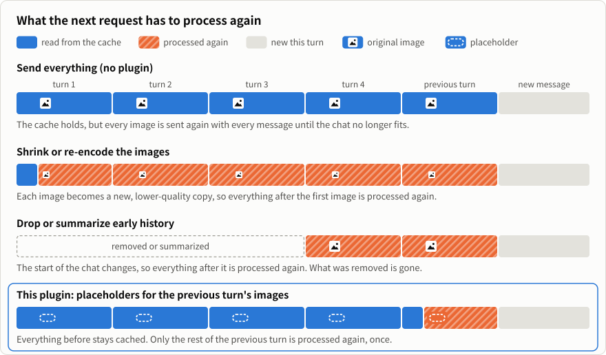
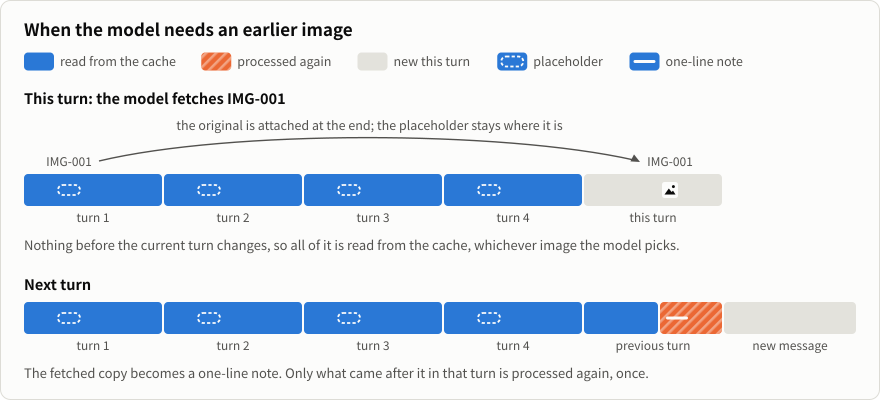

<p align="center">
  
</p>

<h1 align="center">Context Attachment Manager</h1>

<p align="center"><b>Un complemento local para conversaciones con muchas imágenes en Codex, Claude Code y otros agentes.</b><br>Las imágenes anteriores dejan de reenviarse con cada mensaje. El modelo recupera por su identificador la imagen que necesita, incluso después de compactar la conversación.</p>

<p align="center">
  <a href="https://github.com/chipfighter/context-attachment-manager/releases"></a>
  
  <a href="LICENSE"></a>
</p>

<p align="center"><a href="README.md">English</a> · <a href="README_CN.md">简体中文</a> · <a href="README_JA.md">日本語</a> · <a href="README_KO.md">한국어</a> · <b>Español</b> · <a href="README_PT_BR.md">Português (Brasil)</a> · <a href="README_FR.md">Français</a> · <a href="README_DE.md">Deutsch</a></p>

<p align="center">
  
</p>

## Qué hace

Normalmente, un agente vuelve a enviar todas las imágenes anteriores con cada mensaje. Por eso, una conversación larga con muchas imágenes se vuelve más lenta y puede llegar a fallar al enviar un mensaje. Este complemento asigna un número a cada imagen (`IMG-001`, `IMG-002`, …) y, en los mensajes posteriores, envía una breve referencia en su lugar.

- **El modelo recupera la imagen que necesita.** Cuando tiene que volver a ver una imagen anterior, recupera la original por su identificador.
- **Puede distinguir las imágenes.** El modelo anota en una línea lo que muestra cada imagen y también guarda tus comentarios. Las notas quedan en las referencias, incluso después de compactar la conversación.
- **La caché se conserva.** La referencia se escribe una sola vez y después no cambia, así que la conversación anterior se sigue leyendo de la caché de prompts del modelo. Consulta [el diseño](#diseño-conservar-la-caché).
- **Conserva los originales.** Tus imágenes y el historial de la conversación se mantienen intactos.

El complemento está activado por defecto y funciona con el panel cerrado. Puedes usarlo para crear imágenes y vídeos, revisar documentos escaneados o manejar el equipo y el navegador.

## Instalación

Envía este mensaje a tu agente. Identificará la plataforma en la que se ejecuta y hará la instalación correspondiente.

```text
Instala Context Attachment Manager siguiendo estas instrucciones: https://github.com/chipfighter/context-attachment-manager/blob/main/INSTALL.md
```

Después, reinicia el agente. En Claude Desktop, inicia una nueva sesión de Code. Consulta los [agentes compatibles](#agentes-compatibles) y las [instrucciones de instalación, actualización y desinstalación](INSTALL.md) (en inglés).

## El panel, para elegir qué se envía

<p align="center">
  
</p>

- **Busca una imagen** por un detalle o un comentario que recuerdes, como «noche lluviosa» o «la mejor cara».
- **Ten siempre a mano una imagen de referencia.** Ábrela y marca **Send every turn** (Enviar en cada turno).
- **Elige las imágenes manualmente.** Desactiva **Auto-select** (Selección automática) y elige cuáles se enviarán con tu próximo mensaje.

En **Codex**, abre **Context Assets** en el panel lateral de la tarea. En la **pestaña Code de Claude Desktop**, el panel se abre automáticamente cuando hay imágenes. Escribe `/cam` para volver a abrirlo.

## Privacidad

El complemento se ejecuta localmente. Tus imágenes originales y el historial de la conversación se quedan en tu equipo. Las solicitudes van al servicio que ya usa tu agente.

## Cómo lo probamos

En Codex, una conversación con nueve fotogramas clave llegó a 42,4 MB y ya no se podía enviar después de reiniciar el agente o compactar la conversación. Con el complemento, las mismas solicitudes ocupaban 0,12 MB. Los resultados y los pasos para reproducirlos están en la [comparativa en Codex](eval/README.md) y la [comparativa de una tarea larga en Claude Code](eval/long-task/README.md), ambas en inglés.

## Diseño: conservar la caché

Los servicios de modelos guardan en caché el principio de la conversación. Cuando una solicitud empieza exactamente igual que la anterior, esa parte se lee de la caché, lo que es más rápido y mucho más barato. Si cambia algo al principio de la conversación, todo lo que viene después del cambio se vuelve a procesar.

Para reducir una conversación larga siempre hay que cambiar algo. El complemento hace ese cambio lo más tarde posible en la conversación:

<p align="center">
  
</p>

- **La referencia se escribe una sola vez.** La imagen se sustituye por su referencia en el turno siguiente al que apareció, así que solo se vuelve a procesar, una vez, el resto de ese turno. A partir de ahí, la referencia es el mismo texto en todas las solicitudes.
- **Recuperar una imagen no cambia nada de lo anterior.** La original se añade al final del turno actual y su referencia se queda donde estaba. Elija la imagen que elija el modelo, y haya las que haya en la conversación, todo lo anterior al turno actual se sigue leyendo de la caché.
- **El modelo recupera la original.** No es una copia reducida ni un resumen.

<p align="center">
  
</p>

No es gratis. Después de un turno con imágenes, el resto de ese turno se vuelve a procesar una vez, y el modelo escribe una línea breve por cada imagen nueva. Si cambias una imagen antigua en el panel (la desmarcas, la vuelves a marcar o marcas **Send every turn**), la conversación cambia en ese punto y lo que viene después se vuelve a procesar una vez. En nuestra [comparativa de una tarea larga en Claude Code](eval/long-task/README.md) (en inglés), el 87 % de la entrada se leyó de la caché con el complemento y el 91 % sin él.

La tercera fila de la primera figura es también lo que hace la compactación del propio agente, y lo que ocurre al borrar resultados antiguos de herramientas desde la API (por ejemplo, context editing de Anthropic): se elimina contenido del principio y lo que sigue se vuelve a procesar.

## Agentes compatibles

Hemos probado Codex y Claude Code. El panel está disponible en Codex y Claude Desktop. Los demás agentes de la tabla son compatibles mediante adaptadores desarrollados a partir de su código y documentación. Todavía no hemos probado esos adaptadores en los propios agentes. Si usas alguno, [cuéntanos qué tal te fue](https://github.com/chipfighter/context-attachment-manager/issues), tanto si funcionó como si tuviste algún problema.

| Agente | Qué es | Compatibilidad |
|---|---|---|
| [Codex](https://github.com/openai/codex) | Agente de programación de OpenAI para escritorio y terminal | Selección automática y panel, probado |
| [Claude Code](https://github.com/anthropics/claude-code) | Agente de programación de Anthropic para escritorio y terminal | Selección automática y panel (escritorio), probado |
| [WorkBuddy](https://www.workbuddy.cn) | Asistente de trabajo con IA de Tencent para escritorio, con CodeBuddy integrado | Selección automática, pendiente de pruebas |
| [OpenCode](https://github.com/anomalyco/opencode) | Agente de programación de código abierto para terminal, compatible con cualquier proveedor de modelos | Selección automática, pendiente de pruebas |
| [Gemini CLI](https://github.com/google-gemini/gemini-cli) | Agente de código abierto de Google para terminal | Selección automática, pendiente de pruebas |
| [pi](https://github.com/earendil-works/pi) | Agente de programación minimalista y ampliable para terminal | Selección automática (extensión de pi), pendiente de pruebas |
| [DeepSeek Harness](https://github.com/deepseek-ai/deepseek-harness) | Entorno de agentes de DeepSeek en el que todo funciona mediante complementos | Selección automática (complemento de dsh), pendiente de pruebas |
| [Qwen Code](https://github.com/QwenLM/qwen-code) | Agente de código abierto de Qwen para terminal | Selección automática, pendiente de pruebas |
| [Cline](https://github.com/cline/cline) | Agente de programación de código abierto para VS Code, JetBrains y terminal | Selección automática, pendiente de pruebas |
| [Kilo Code](https://github.com/Kilo-Org/kilocode) | Agente de programación de código abierto para VS Code, JetBrains y terminal | Selección automática, pendiente de pruebas |
| [goose](https://github.com/aaif-goose/goose) | Agente de código abierto para escritorio y terminal, ampliable con MCP | Selección automática, pendiente de pruebas |
| [Cherry Studio](https://github.com/CherryHQ/cherry-studio) | Cliente de chat de escritorio de código abierto, compatible con distintos modelos | Selección automática, pendiente de pruebas |

Para configurar estos agentes, consulta [INSTALL.md](INSTALL.md#other-agents). Para conectar otro agente, consulta [ADAPTERS.md](ADAPTERS.md). Ambas guías están en inglés.

## Preguntas frecuentes

### ¿Por qué Codex y Claude Code se vuelven lentos en una conversación larga con muchas imágenes?

El agente vuelve a enviar todas las imágenes anteriores con cada mensaje. Por eso, una conversación larga con muchas imágenes se vuelve más lenta y puede llegar a fallar al enviar un mensaje. En Codex, una conversación con nueve fotogramas clave llegó a 42,4 MB y ya no se podía enviar después de reiniciar el agente o compactar la conversación. Con Context Attachment Manager, las mismas solicitudes ocupaban 0,12 MB.

### ¿Context Attachment Manager rompe la caché de prompts?

Muy poco. La referencia se escribe una sola vez y después no cambia, y la imagen recuperada se añade al final del turno actual, así que los turnos anteriores se siguen leyendo de la caché. Después de un turno con imágenes, el resto de ese turno se vuelve a procesar una vez. En nuestra comparativa de una tarea larga en Claude Code, el 87 % de la entrada se leyó de la caché con el complemento y el 91 % sin él.

### ¿En qué se diferencia de la compactación o de reducir las imágenes?

La compactación y el descarte del historial antiguo eliminan el principio de la conversación, y reducir las imágenes lo modifica. En ambos casos se vuelve a procesar casi toda la conversación, y al modelo solo le queda un resumen o una copia reducida. Con Context Attachment Manager solo se vuelve a procesar el resto del turno anterior, y el modelo recupera la imagen original por su identificador.

### ¿El modelo puede volver a ver una imagen anterior?

Sí. Cada imagen tiene un identificador, como `IMG-001`, y el modelo recupera la original cuando necesita volver a verla, incluso después de compactar la conversación.

### ¿Mis imágenes se borran o se envían a otro sitio?

No. El complemento se ejecuta en tu equipo. Tus imágenes originales y el historial de la conversación se mantienen intactos, y las solicitudes van al servicio que ya usa tu agente.

### ¿Con qué agentes funciona? ¿Es gratis?

Codex y Claude Code están probados. WorkBuddy, OpenCode, Gemini CLI, pi, DeepSeek Harness, Qwen Code, Cline, Kilo Code, goose y Cherry Studio son compatibles mediante adaptadores que aún no hemos probado. Es gratuito y de código abierto, con licencia MIT.

<p align="center"><sub><a href="CHANGELOG.md">Historial de cambios</a> · <a href="CONTRIBUTING.md">Cómo contribuir</a> · <a href="LICENSE">Licencia MIT</a></sub></p>
