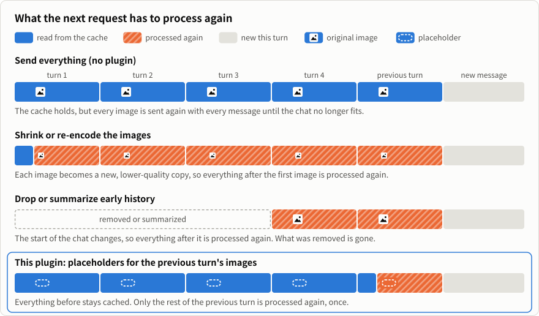
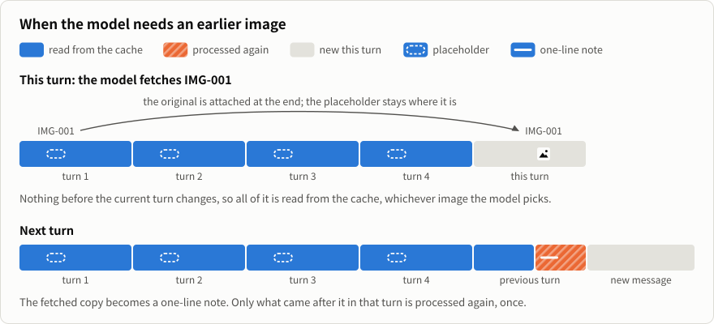

<p align="center">
  
</p>

<h1 align="center">Context Attachment Manager</h1>

<p align="center"><b>Codex、Claude Code などのエージェントで、画像が多い会話のためのローカルプラグイン。</b><br>以前の画像をメッセージごとに送り直しません。必要な画像はモデルが ID で取り出します。会話を圧縮したあとも同じです。</p>

<p align="center">
  <a href="https://github.com/chipfighter/context-attachment-manager/releases"></a>
  
  <a href="LICENSE"></a>
</p>

<p align="center"><a href="README.md">English</a> · <a href="README_CN.md">简体中文</a> · <b>日本語</b> · <a href="README_KO.md">한국어</a> · <a href="README_ES.md">Español</a> · <a href="README_PT_BR.md">Português (Brasil)</a> · <a href="README_FR.md">Français</a> · <a href="README_DE.md">Deutsch</a></p>

<p align="center">
  
</p>

## できること

エージェントは通常、メッセージを送るたびに以前の画像をすべて送り直します。画像が増えると会話は重くなり、送信できなくなることもあります。このプラグインは画像ごとに番号（`IMG-001`、`IMG-002`…）を付け、以前の画像の代わりに短いプレースホルダーを送ります。

- **必要な画像だけ取り出す**：以前の画像をもう一度見る必要があるとき、モデルが ID で元画像を取り出します。
- **どの画像か見分けられる**：モデルが画像ごとに見た目の特徴を一行で記録し、あなたの評価も残します。これはプレースホルダーに入るので、会話を圧縮したあとも残ります。
- **キャッシュをなるべく壊さない**：プレースホルダーは一度書いたら変わらないので、それまでの会話はモデルのプロンプトキャッシュから読み込まれます。詳しくは[設計](#設計キャッシュをなるべく壊さない)をご覧ください。
- **何も削除しない**：元の画像と会話履歴はそのままです。

最初からオンで、パネルを開く必要はありません。主な用途：画像・動画の制作、スキャン文書、パソコンやブラウザーの操作。

## インストール

次の文をお使いのエージェントに送ってください。実行中のプラットフォームを確認し、それに合わせてインストールします。

```text
次の手順に従って、Context Attachment Manager をインストールしてください：https://github.com/chipfighter/context-attachment-manager/blob/main/INSTALL.md
```

インストール後はエージェントを再起動してください（Claude Desktop では新しい Code セッションを始めてください）。[対応エージェント](#対応エージェント)、[インストール・更新・アンインストールの手順](INSTALL.md)（英語）もご覧ください。

## 自分で選びたいときは、パネルで

<p align="center">
  
</p>

- **覚えていることから検索**：「雨の夜」「いちばん良い顔」など、画像の特徴や感想で探せます。
- **大切な参考画像を固定**：画像を開き、**Send every turn**（毎ターン送信）にチェックを入れます。
- **送る画像を自分で選択**：**Auto-select**（自動選択）をオフにして、次のメッセージに含める画像を選びます。

**Codex** ではタスクのサイドパネルから **Context Assets** を開きます。**Claude Desktop の Code タブ**では画像があると自動で開き、`/cam` で再び開けます。

## プライバシー

プラグインはローカルで動作します。元の画像と会話履歴は自分のコンピューターに残り、リクエストはエージェントが元から使っているサービスに送られます。

## 効果の検証

Codex では、9 枚のキーフレームがある会話が 42.4 MB になり、再起動や圧縮のあとに送信できませんでした。プラグインを入れると、同じリクエストは 0.12 MB でした。結果と再現手順は [Codex の比較検証](eval/README.md)と [Claude Code の長期タスク検証](eval/long-task/README.md)（英語）をご覧ください。

## 設計：キャッシュをなるべく壊さない

モデルのサービスは会話の先頭部分をキャッシュします。リクエストの先頭が前回とまったく同じなら、その部分はキャッシュから読み込まれ、速く、料金もずっと安くなります。会話の前のほうが変わると、変わった箇所から後ろはすべて処理し直しになります。

長い会話を小さくするには、どこかを変えるしかありません。このプラグインは、変える場所をできるだけ後ろにします。

<p align="center">
  
</p>

- **プレースホルダーは一度だけ書く**：画像は、登場した次のターンでプレースホルダーに置き換わります。処理し直すのはそのターンの残りだけで、一度きりです。それ以降、プレースホルダーはどのリクエストでも同じ文面です。
- **取り出しても前の部分は変わらない**：元画像は現在のターンの末尾に追加され、プレースホルダーは元の位置に残ります。会話に画像が何枚あっても、モデルがどれを選んでも、現在のターンより前はキャッシュから読み込まれます。
- **戻ってくるのは元画像**：縮小したコピーでも、要約でもありません。

<p align="center">
  
</p>

コストがないわけではありません。画像のあったターンが終わると、そのターンの残りを一度処理し直し、モデルは新しい画像ごとに短い一行を書きます。パネルで古い画像の設定（チェックを外す、戻す、**Send every turn**）を変えると、会話がその画像の位置で変わるため、それ以降を一度処理し直します。[Claude Code の長期タスク検証](eval/long-task/README.md)（英語）では、キャッシュから読み込まれた入力は、プラグインありで 87%、なしで 91% でした。

1 つ目の図の 3 行目は、エージェント自身の圧縮や、API 側で古いツール結果を消す機能（Anthropic の context editing など）がしていることでもあります。前のほうの内容が取り除かれ、それ以降は処理し直しになります。

## 対応エージェント

Codex と Claude Code は動作確認済みで、Codex と Claude Desktop にはパネルもあります。ほかのエージェントにも対応しています。接続層は各エージェントのコードとドキュメントをもとに書きましたが、まだ実際には試していません。お使いの方は、動いたかどうか[ぜひ教えてください](https://github.com/chipfighter/context-attachment-manager/issues)。

| エージェント | 概要 | 対応状況 |
|---|---|---|
| [Codex](https://github.com/openai/codex) | OpenAI のコーディングエージェント（デスクトップ版・CLI） | 自動選択＋パネル、動作確認済み |
| [Claude Code](https://github.com/anthropics/claude-code) | Anthropic のコーディングエージェント（デスクトップ版・CLI） | 自動選択＋パネル（デスクトップ版）、動作確認済み |
| [WorkBuddy](https://www.workbuddy.cn) | Tencent のデスクトップ AI アシスタント（CodeBuddy 内蔵） | 自動選択、未検証 |
| [OpenCode](https://github.com/anomalyco/opencode) | どのモデルサービスにもつながるオープンソースのターミナル型エージェント | 自動選択、未検証 |
| [Gemini CLI](https://github.com/google-gemini/gemini-cli) | Google のオープンソースのターミナル型エージェント | 自動選択、未検証 |
| [pi](https://github.com/earendil-works/pi) | ミニマルで拡張できるターミナル型コーディングエージェント | 自動選択（pi 拡張）、未検証 |
| [DeepSeek Harness](https://github.com/deepseek-ai/deepseek-harness) | すべてがプラグインの DeepSeek のエージェント基盤 | 自動選択（dsh プラグイン）、未検証 |
| [Qwen Code](https://github.com/QwenLM/qwen-code) | Qwen のオープンソースのターミナル型エージェント | 自動選択、未検証 |
| [Cline](https://github.com/cline/cline) | VS Code・JetBrains・ターミナルで使えるオープンソースのコーディングエージェント | 自動選択、未検証 |
| [Kilo Code](https://github.com/Kilo-Org/kilocode) | VS Code・JetBrains・ターミナルで使えるオープンソースのコーディングエージェント | 自動選択、未検証 |
| [goose](https://github.com/aaif-goose/goose) | MCP で拡張できる、デスクトップとターミナルのオープンソースエージェント | 自動選択、未検証 |
| [Cherry Studio](https://github.com/CherryHQ/cherry-studio) | 多くのモデルにつながるオープンソースのデスクトップ AI チャット | 自動選択、未検証 |

これらのエージェントの設定手順は [INSTALL.md](INSTALL.md#other-agents)（英語）をご覧ください。ほかのエージェントを接続するには [ADAPTERS.md](ADAPTERS.md)（英語）をご覧ください。

## よくある質問

### Codex や Claude Code で、画像の多い会話が重くなるのはなぜですか？

エージェントはメッセージを送るたびに以前の画像をすべて送り直すため、画像が増えると会話は重くなり、送信できなくなることもあります。Codex では、9 枚のキーフレームがある会話が 42.4 MB になり、再起動や圧縮のあとに送信できませんでした。Context Attachment Manager を入れると、同じリクエストは 0.12 MB でした。

### Context Attachment Manager を使うと、プロンプトキャッシュは効かなくなりますか？

影響はわずかです。プレースホルダーは一度書いたら変わらず、取り出した元画像は現在のターンの末尾に追加されるので、それより前のターンはキャッシュから読み込まれます。画像のあったターンが終わると、そのターンの残りを一度処理し直します。Claude Code の長期タスク検証では、キャッシュから読み込まれた入力は、プラグインありで 87%、なしで 91% でした。

### 会話の圧縮や画像の縮小とは何が違いますか？

会話の圧縮や古い履歴の削除は会話の前のほうを取り除き、画像の縮小は前のほうを書き換えます。どちらも会話のほぼ全体が処理し直しになり、モデルの手元に残るのは要約か縮小したコピーです。Context Attachment Manager では、処理し直すのは前のターンの残りだけで、モデルは ID で元画像を取り出せます。

### モデルは以前の画像をもう一度見られますか？

はい。画像には `IMG-001` のような ID が付き、もう一度見る必要があるとき、モデルが ID で元画像を取り出します。会話を圧縮したあとも同じです。

### 画像が削除されたり、ほかの場所に送られたりしませんか？

いいえ。プラグインはお使いのコンピューター上で動作します。元の画像と会話履歴はそのまま残り、リクエストはエージェントが元から使っているサービスに送られます。

### どのエージェントで使えますか？ 無料ですか？

Codex と Claude Code は検証済みです。WorkBuddy、OpenCode、Gemini CLI、pi、DeepSeek Harness、Qwen Code、Cline、Kilo Code、goose、Cherry Studio はアダプターで対応していますが、まだ検証していません。MIT ライセンスのオープンソースで、無料です。

<p align="center"><sub><a href="CHANGELOG.md">変更履歴（英語）</a> · <a href="CONTRIBUTING.md">開発への参加（英語）</a> · <a href="LICENSE">MIT ライセンス</a></sub></p>
