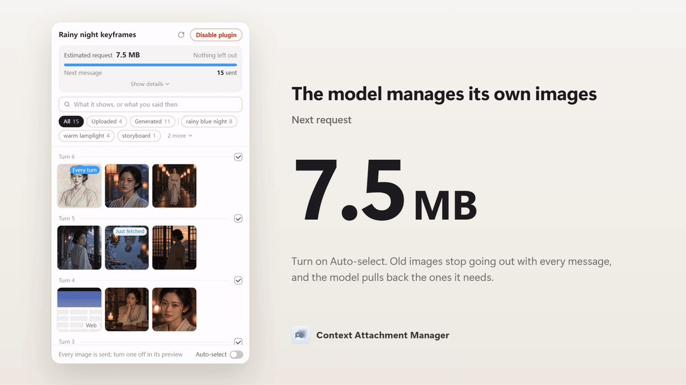
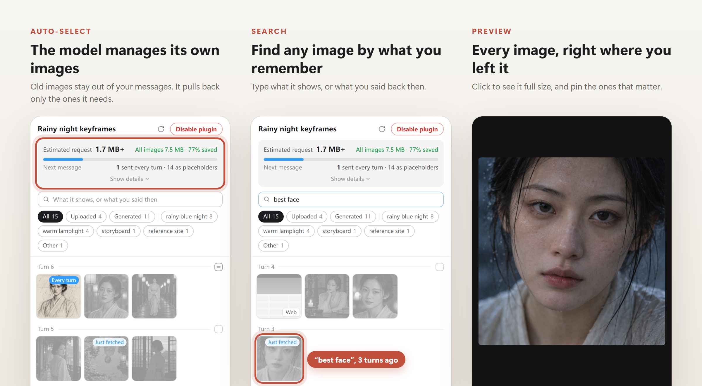

<p align="center">
  
</p>

<h1 align="center">Context Attachment Manager</h1>

<p align="center"><b>Codex, Claude Code 등에서 이미지가 많은 대화를 위한 로컬 플러그인입니다.</b><br>이전 이미지는 모델이 필요할 때만 번호로 불러옵니다. 대화가 압축된 뒤에도 같은 방식으로 작동합니다.</p>

<p align="center">
  <a href="https://github.com/chipfighter/context-attachment-manager/releases"></a>
  
  <a href="LICENSE"></a>
</p>

<p align="center"><a href="README.md">English</a> · <a href="README_CN.md">简体中文</a> · <a href="README_JA.md">日本語</a> · <b>한국어</b> · <a href="README_ES.md">Español</a> · <a href="README_PT_BR.md">Português (Brasil)</a> · <a href="README_FR.md">Français</a> · <a href="README_DE.md">Deutsch</a></p>

<p align="center">
  
</p>

## 주요 기능

에이전트는 보통 메시지를 보낼 때마다 앞서 보낸 이미지를 모두 다시 전송합니다. 이미지가 쌓이면 대화가 느려지고, 결국 메시지를 보내지 못할 수도 있습니다. 이 플러그인은 각 이미지에 `IMG-001`, `IMG-002` 같은 번호를 붙이고, 이전 이미지는 짧은 텍스트로 바꿔 보냅니다.

- **필요한 이미지만 불러오기** — 모델이 이전 이미지를 다시 봐야 할 때 번호로 원본을 불러옵니다.
- **이미지 구분하기** — 모델은 이미지마다 눈에 보이는 특징과 사용자가 남긴 의견을 한 줄로 기록합니다. 이 내용은 이미지를 대신하는 텍스트에 들어 있어 대화가 압축된 뒤에도 남습니다.
- **원본 유지** — 원본 이미지와 대화 기록은 그대로 보존됩니다.

기본으로 켜져 있으므로 패널을 열 필요가 없습니다. 이미지나 영상 제작, 스캔 문서 작업, 컴퓨터나 브라우저 조작에 활용할 수 있습니다.

## 설치

아래 문장을 에이전트에게 보내세요. 에이전트가 실행 중인 플랫폼을 확인해 그에 맞게 설치합니다.

```text
https://github.com/chipfighter/context-attachment-manager/blob/main/INSTALL.md 의 안내에 따라 Context Attachment Manager를 설치해 줘.
```

설치가 끝나면 에이전트를 다시 시작하세요. Claude Desktop에서는 새 Code 세션을 시작하면 됩니다. [지원 에이전트](#지원-에이전트)와 [설치, 업데이트 및 제거 안내](INSTALL.md)(영어)를 확인할 수 있습니다.

## 패널에서 직접 선택하기

<p align="center">
  
</p>

- **기억나는 단서로 이미지 찾기** — “비 오는 밤”이나 “얼굴이 가장 잘 나온 컷”처럼 기억나는 특징이나 의견으로 검색하세요.
- **중요한 참고 이미지 고정하기** — 이미지를 열고 **Send every turn**(매번 보내기)을 선택하세요.
- **보낼 이미지 직접 선택하기** — **Auto-select**(자동 선택)를 끈 다음, 다음 메시지에 포함할 이미지를 고르세요.

**Codex**에서는 작업의 사이드 패널에서 **Context Assets**를 엽니다. **Claude Desktop의 Code 탭**에서는 이미지가 있으면 패널이 자동으로 열립니다. 다시 열려면 `/cam`을 입력하세요.

## 개인정보 보호

플러그인은 로컬에서 실행됩니다. 원본 이미지와 대화 기록은 내 컴퓨터에 남고, 요청은 에이전트가 원래 사용하던 서비스로 전송됩니다.

## 테스트 결과

Codex에서 키프레임 9개가 포함된 대화의 요청 크기가 42.4 MB까지 커졌고, Codex를 다시 시작하거나 대화를 압축한 뒤에는 요청을 전송할 수 없었습니다. 플러그인을 사용했을 때 같은 요청의 크기는 0.12 MB였습니다. 결과와 재현 방법은 [Codex 비교 테스트](eval/README.md)(영어)와 [Claude Code 장시간 작업 비교 테스트](eval/long-task/README.md)(영어)에서 확인할 수 있습니다.

## 지원 에이전트

Codex와 Claude Code는 실제로 테스트했습니다. 패널은 Codex와 Claude Desktop에서 사용할 수 있습니다. 나머지 에이전트도 각 플랫폼의 코드와 문서를 바탕으로 만든 어댑터를 통해 지원하며, 실제 환경에서는 아직 테스트하지 않았습니다. 아래 에이전트 중 하나를 사용 중이라면 잘 작동했는지 여부와 관계없이 [사용 결과를 알려 주세요](https://github.com/chipfighter/context-attachment-manager/issues).

| 에이전트 | 소개 | 지원 범위 |
|---|---|---|
| [Codex](https://github.com/openai/codex) | OpenAI의 데스크톱 및 명령줄 코딩 에이전트 | 자동 선택 및 패널, 테스트 완료 |
| [Claude Code](https://github.com/anthropics/claude-code) | Anthropic의 데스크톱 및 명령줄 코딩 에이전트 | 자동 선택 및 패널(데스크톱), 테스트 완료 |
| [WorkBuddy](https://www.workbuddy.cn) | CodeBuddy를 내장한 Tencent의 데스크톱 AI 업무 도우미 | 자동 선택, 아직 테스트하지 않음 |
| [OpenCode](https://github.com/anomalyco/opencode) | 다양한 모델 제공업체를 연결할 수 있는 오픈소스 터미널 코딩 에이전트 | 자동 선택, 아직 테스트하지 않음 |
| [Gemini CLI](https://github.com/google-gemini/gemini-cli) | Google의 오픈소스 터미널 에이전트 | 자동 선택, 아직 테스트하지 않음 |
| [pi](https://github.com/earendil-works/pi) | 간결하고 확장 가능한 터미널 코딩 에이전트 | 자동 선택(pi 확장), 아직 테스트하지 않음 |
| [DeepSeek Harness](https://github.com/deepseek-ai/deepseek-harness) | 모든 구성 요소가 플러그인인 DeepSeek의 에이전트 프레임워크 | 자동 선택(dsh 플러그인), 아직 테스트하지 않음 |
| [Qwen Code](https://github.com/QwenLM/qwen-code) | Qwen의 오픈소스 터미널 에이전트 | 자동 선택, 아직 테스트하지 않음 |
| [Cline](https://github.com/cline/cline) | VS Code, JetBrains, 터미널에서 사용할 수 있는 오픈소스 코딩 에이전트 | 자동 선택, 아직 테스트하지 않음 |
| [Kilo Code](https://github.com/Kilo-Org/kilocode) | VS Code, JetBrains, 터미널에서 사용할 수 있는 오픈소스 코딩 에이전트 | 자동 선택, 아직 테스트하지 않음 |
| [goose](https://github.com/aaif-goose/goose) | MCP로 확장할 수 있는 오픈소스 데스크톱 및 터미널 에이전트 | 자동 선택, 아직 테스트하지 않음 |
| [Cherry Studio](https://github.com/CherryHQ/cherry-studio) | 여러 모델을 사용할 수 있는 오픈소스 데스크톱 채팅 앱 | 자동 선택, 아직 테스트하지 않음 |

위 에이전트의 설치 방법은 [INSTALL.md](INSTALL.md#other-agents)(영어)에 있습니다. 다른 에이전트를 연결하려면 [어댑터 안내](ADAPTERS.md)(영어)를 참고하세요.

<p align="center"><sub><a href="CHANGELOG.md">변경 기록</a> · <a href="CONTRIBUTING.md">기여하기</a> · <a href="LICENSE">MIT 라이선스</a></sub></p>
