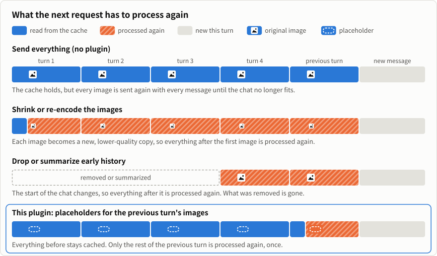
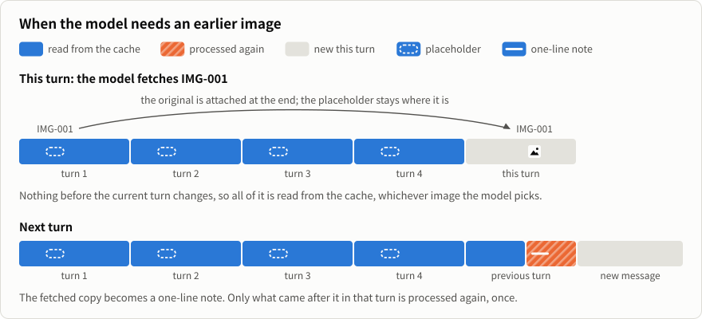

<p align="center">
  
</p>

<h1 align="center">Context Attachment Manager</h1>

<p align="center"><b>Um plugin local para conversas com muitas imagens no Codex, no Claude Code e em outros agentes.</b><br>As imagens anteriores deixam de ser reenviadas a cada mensagem. O modelo recupera pelo ID a imagem de que precisa, mesmo depois de a conversa ser compactada.</p>

<p align="center">
  <a href="https://github.com/chipfighter/context-attachment-manager/releases"></a>
  
  <a href="LICENSE"></a>
</p>

<p align="center"><a href="README.md">English</a> · <a href="README_CN.md">简体中文</a> · <a href="README_JA.md">日本語</a> · <a href="README_KO.md">한국어</a> · <a href="README_ES.md">Español</a> · <b>Português (Brasil)</b> · <a href="README_FR.md">Français</a> · <a href="README_DE.md">Deutsch</a></p>

<p align="center">
  
</p>

## O que o plugin faz

Normalmente, o agente reenvia todas as imagens anteriores a cada mensagem. Com muitas imagens, uma conversa longa fica mais lenta e o envio pode até falhar. O plugin dá um número a cada imagem (`IMG-001`, `IMG-002`, …) e, nas mensagens seguintes, envia uma referência curta no lugar da imagem.

- **O modelo busca a imagem de que precisa.** Quando precisa rever uma imagem anterior, o modelo recupera a original pelo ID.
- **O modelo consegue distinguir as imagens.** Ele anota em uma linha o que cada imagem mostra e também guarda seus comentários. As anotações ficam nas referências, mesmo depois de a conversa ser compactada.
- **Os arquivos originais são preservados.** Suas imagens e o histórico da conversa permanecem intactos.

O plugin vem ativado por padrão e funciona com o painel fechado. Você pode usá-lo para criar imagens e vídeos, consultar documentos digitalizados ou operar o computador e o navegador.

## Instalação

Envie a mensagem abaixo ao seu agente. Ele identifica a plataforma em que está rodando e faz a instalação correspondente.

```text
Instale o Context Attachment Manager seguindo estas instruções: https://github.com/chipfighter/context-attachment-manager/blob/main/INSTALL.md
```

Depois da instalação, reinicie o agente. No Claude Desktop, inicie uma nova sessão do Code. Confira os [agentes compatíveis](#agentes-compatíveis) e as [instruções de instalação, atualização e desinstalação](INSTALL.md) (em inglês).

## O painel, para escolher o que enviar

<p align="center">
  
</p>

- **Encontre uma imagem** por um detalhe ou comentário de que você se lembra, como “noite chuvosa” ou “melhor rosto”.
- **Mantenha uma imagem de referência à mão.** Abra a imagem e marque **Send every turn** (Enviar a cada turno).
- **Escolha as imagens manualmente.** Desative **Auto-select** (Seleção automática) e escolha quais imagens vão junto com a próxima mensagem.

No **Codex**, abra **Context Assets** no painel lateral da tarefa. Na **aba Code do Claude Desktop**, o painel abre automaticamente quando há imagens. Digite `/cam` para reabri-lo.

## Privacidade

O plugin roda localmente. As imagens originais e o histórico da conversa ficam no seu computador. As solicitações vão para o serviço que seu agente já usa.

## Como testamos

No Codex, uma conversa com nove quadros-chave chegou a 42,4 MB, e o envio falhou depois de reiniciar o agente ou compactar a conversa. Com o plugin, as mesmas solicitações ficaram com 0,12 MB. Consulte o [comparativo no Codex](eval/README.md) e o [comparativo de uma tarefa longa no Claude Code](eval/long-task/README.md) para ver os resultados e como reproduzi-los. Os dois estão em inglês.

## Design: preservar o cache

Os serviços de modelos guardam em cache o início da conversa. Quando uma solicitação começa exatamente igual à anterior, essa parte é lida do cache, o que é mais rápido e bem mais barato. Se algo muda no início da conversa, tudo o que vem depois da mudança é processado de novo.

Para reduzir uma conversa longa, sempre é preciso mudar alguma coisa. O plugin faz essa mudança o mais tarde possível na conversa:

<p align="center">
  
</p>

- **A referência é escrita uma única vez.** A imagem é trocada pela referência no turno seguinte àquele em que apareceu, então só o restante desse turno é processado de novo, uma vez. Daí em diante, a referência é o mesmo texto em todas as solicitações.
- **Buscar uma imagem não muda nada do que veio antes.** A original é adicionada ao final do turno atual, e a referência fica onde estava. Seja qual for a imagem que o modelo escolher, e quantas houver na conversa, tudo o que vem antes do turno atual continua sendo lido do cache.
- **O modelo recebe a original.** Não é uma cópia reduzida nem um resumo.

<p align="center">
  
</p>

Isso tem um custo. Depois de um turno com imagens, o restante desse turno é processado de novo uma vez, e o modelo escreve uma linha curta para cada imagem nova. Se você alterar uma imagem antiga no painel (desmarcar, marcar de novo ou marcar **Send every turn**), a conversa muda naquele ponto e o que vem depois é processado de novo uma vez. No nosso [comparativo de uma tarefa longa no Claude Code](eval/long-task/README.md) (em inglês), 87% da entrada foi lida do cache com o plugin e 91% sem ele.

A terceira linha da primeira figura também é o que a compactação do próprio agente faz, e o que acontece quando resultados antigos de ferramentas são apagados pela API (por exemplo, o context editing da Anthropic): o conteúdo do início é removido e o que vem depois é processado de novo.

## Agentes compatíveis

Testamos o Codex e o Claude Code. O painel está disponível no Codex e no Claude Desktop. Os demais agentes da tabela são compatíveis por meio de adaptadores desenvolvidos com base no código e na documentação de cada um. Ainda não testamos esses adaptadores nos próprios agentes. Se você usa algum deles, [conte como foi](https://github.com/chipfighter/context-attachment-manager/issues), tanto se deu certo quanto se encontrou algum problema.

| Agente | O que é | Compatibilidade |
|---|---|---|
| [Codex](https://github.com/openai/codex) | Agente de programação da OpenAI para desktop e terminal | Seleção automática e painel, testados |
| [Claude Code](https://github.com/anthropics/claude-code) | Agente de programação da Anthropic para desktop e terminal | Seleção automática e painel (desktop), testados |
| [WorkBuddy](https://www.workbuddy.cn) | Assistente de trabalho com IA da Tencent para desktop, com CodeBuddy integrado | Seleção automática, ainda não testada |
| [OpenCode](https://github.com/anomalyco/opencode) | Agente de programação de código aberto para terminal, compatível com qualquer provedor de modelos | Seleção automática, ainda não testada |
| [Gemini CLI](https://github.com/google-gemini/gemini-cli) | Agente de código aberto do Google para terminal | Seleção automática, ainda não testada |
| [pi](https://github.com/earendil-works/pi) | Agente de programação minimalista e extensível para terminal | Seleção automática (extensão do pi), ainda não testada |
| [DeepSeek Harness](https://github.com/deepseek-ai/deepseek-harness) | Ambiente de agentes da DeepSeek em que tudo funciona por plugins | Seleção automática (plugin do dsh), ainda não testada |
| [Qwen Code](https://github.com/QwenLM/qwen-code) | Agente de código aberto do Qwen para terminal | Seleção automática, ainda não testada |
| [Cline](https://github.com/cline/cline) | Agente de programação de código aberto para VS Code, JetBrains e terminal | Seleção automática, ainda não testada |
| [Kilo Code](https://github.com/Kilo-Org/kilocode) | Agente de programação de código aberto para VS Code, JetBrains e terminal | Seleção automática, ainda não testada |
| [goose](https://github.com/aaif-goose/goose) | Agente de código aberto para desktop e terminal, extensível com MCP | Seleção automática, ainda não testada |
| [Cherry Studio](https://github.com/CherryHQ/cherry-studio) | Cliente de chat de código aberto para desktop, compatível com vários modelos | Seleção automática, ainda não testada |

Para configurar esses agentes, consulte [INSTALL.md](INSTALL.md#other-agents). Para conectar outro agente, consulte [ADAPTERS.md](ADAPTERS.md). Os dois guias estão em inglês.

<p align="center"><sub><a href="CHANGELOG.md">Histórico de alterações</a> · <a href="CONTRIBUTING.md">Como contribuir</a> · <a href="LICENSE">Licença MIT</a></sub></p>
