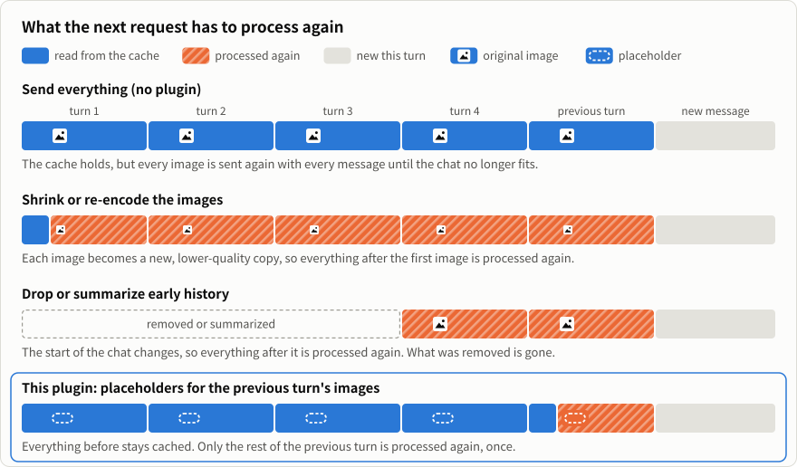

<p align="center">
  
</p>

<h1 align="center">Context Attachment Manager</h1>

<p align="center"><b>Conversas longas e cheias de imagens no Codex e no Claude Code, sem ficarem lentas.</b><br>As imagens anteriores viram uma referência de uma linha com um ID. Quando o modelo precisa de uma delas de novo, recupera a original pelo ID, mesmo depois de a conversa ser compactada.</p>

<p align="center">
  <a href="https://github.com/chipfighter/context-attachment-manager/releases"></a>
  
  <a href="LICENSE"></a>
</p>

<p align="center"><a href="README.md">English</a> · <a href="README_CN.md">简体中文</a> · <a href="README_JA.md">日本語</a> · <a href="README_KO.md">한국어</a> · <a href="README_ES.md">Español</a> · <b>Português (Brasil)</b> · <a href="README_FR.md">Français</a> · <a href="README_DE.md">Deutsch</a></p>

<p align="center">
  <picture>
    <source media="(prefers-color-scheme: dark)" srcset="docs/images/hero-dark.gif">
    
  </picture>
</p>

<table>
  <tr>
    <td align="center" width="33%"><h3>42,4 MB → 0,12 MB</h3>Uma solicitação em uma conversa<br>do Codex com nove quadros-chave</td>
    <td align="center" width="33%"><h3>20/20 contra 8/20</h3>Perguntas sobre as imagens<br>após a compactação (Sonnet 5.5)</td>
    <td align="center" width="33%"><h3>Custo quase igual</h3>Maior solicitação: 41.859<br>contra 110.671 tokens</td>
  </tr>
</table>

## Comece em três passos

**1. Instale.** Envie a mensagem abaixo ao seu agente. Ele identifica a plataforma em que está rodando e faz a instalação correspondente.

```text
Instale o Context Attachment Manager seguindo estas instruções: https://github.com/chipfighter/context-attachment-manager/blob/main/INSTALL.md
```

Depois da instalação, reinicie o agente. No Claude Desktop, inicie uma nova sessão do Code. Para instalar manualmente, veja as [instruções de instalação, atualização e desinstalação](INSTALL.md) (em inglês).

**2. Trabalhe como sempre.** O plugin vem ativado por padrão. As imagens de turnos anteriores são enviadas como referências de uma linha; as imagens novas e as referências que você fixar são enviadas normalmente. Uma referência fica assim:

```text
[Image IMG-004 omitted | shot-1.png | generated image | turn 2 | 505×505]
Features: place: Street | Qinghe | medium shot, umbrella, lanterns
For the original, call cam_view_image with "IMG-004".
```

**3. O modelo busca pelo ID.** Quando precisa rever uma imagem anterior, o modelo recupera a original pelo ID, mesmo depois da compactação. Nada é apagado, e suas imagens e o histórico da conversa ficam no seu computador.

## O painel: navegue por personagem e lugar

<p align="center">
  <picture>
    <source media="(prefers-color-scheme: dark)" srcset="docs/images/panel-dark.png">
    
  </picture>
</p>

O plugin funciona com o painel fechado; abra-o quando quiser decidir você mesmo:

- **Navegue por personagem e lugar.** As imagens são organizadas em personagens, lugares, telas e documentos, com um cartão por nome. Ao abrir um personagem, você vê primeiro os designs e depois as cenas em que ele aparece, lugar por lugar.
- **Encontre uma imagem** por um detalhe ou comentário de que você se lembra, como “noite chuvosa” ou “melhor rosto”.
- **Mantenha uma imagem de referência à mão.** Abra a imagem e marque **Send every turn** (Enviar a cada turno).
- **Escolha as imagens manualmente.** Desative **Auto-select** (Seleção automática) e escolha quais imagens vão junto com a próxima mensagem.

No **Codex**, abra **Context Assets** no painel lateral da tarefa. Na **aba Code do Claude Desktop**, o painel abre automaticamente quando há imagens. Digite `/cam` para reabri-lo.

## Resultados

- **Codex**: uma conversa com nove quadros-chave chegou a 42,4 MB, e o envio falhou depois de reiniciar o agente ou compactar a conversa. Com o plugin, as mesmas solicitações ficaram com 0,12 MB.
- **Claude Code (Sonnet 5.5)**: em uma tarefa de curta-metragem de 16 turnos, com imagens que existem só na conversa, compactamos a conversa e depois fizemos perguntas sobre essas imagens. Com o plugin, ele acertou as 20 perguntas; sem o plugin, acertou 8. A maior solicitação teve 41.859 tokens em vez de 110.671, com custo praticamente igual.

Consulte o [comparativo no Codex](eval/README.md), o [comparativo de compactação no Claude Code](eval/compaction/README.md) e o [comparativo de uma tarefa longa no Claude Code](eval/long-task/README.md) para ver os resultados e como reproduzi-los. Todos estão em inglês.

## Como funciona: preservar o cache

Os serviços de modelos guardam em cache o início da conversa. Quando uma solicitação começa exatamente igual à anterior, essa parte é lida do cache, o que é mais rápido e bem mais barato. Se algo muda no início da conversa, tudo o que vem depois da mudança é processado de novo. O plugin faz sua mudança o mais tarde possível na conversa:

<p align="center">
  
</p>

- **A referência é escrita uma única vez.** A imagem é trocada pela referência no turno seguinte àquele em que apareceu e, daí em diante, é o mesmo texto em todas as solicitações.
- **Buscar uma imagem não muda nada do que veio antes.** A original é adicionada ao final do turno atual e a referência fica onde estava, então os turnos anteriores continuam sendo lidos do cache.
- **O modelo recebe a original.** Não é uma cópia reduzida nem um resumo.

<details>
<summary>Como uma imagem é buscada, e o que isso custa</summary>

<p align="center">
  
</p>

Isso tem um custo. Depois de um turno com imagens, o restante desse turno é processado de novo uma vez, e o modelo escreve uma linha curta para cada imagem nova. Se você alterar uma imagem antiga no painel (desmarcar, marcar de novo ou marcar **Send every turn**), a conversa muda naquele ponto e o que vem depois é processado de novo uma vez. No nosso [comparativo de uma tarefa longa no Claude Code](eval/long-task/README.md) (em inglês), 87% da entrada foi lida do cache com o plugin e 91% sem ele.

A compactação do próprio agente, e a remoção de resultados antigos de ferramentas pela API (por exemplo, o context editing da Anthropic), removem o conteúdo do início, então o que vem depois é processado de novo: é a terceira linha da primeira figura.

</details>

## Agentes compatíveis

Testamos o Codex e o Claude Code. O painel está disponível no Codex e no Claude Desktop. Os demais agentes da tabela são compatíveis por meio de adaptadores desenvolvidos com base no código e na documentação de cada um. Ainda não testamos esses adaptadores nos próprios agentes. Se você usa algum deles, [conte como foi](https://github.com/chipfighter/context-attachment-manager/issues), tanto se deu certo quanto se encontrou algum problema.

| Agente | O que é | Compatibilidade |
|---|---|---|
| [Codex](https://github.com/openai/codex) | Agente de programação da OpenAI para desktop e terminal | Seleção automática e painel, testados |
| [Claude Code](https://github.com/anthropics/claude-code) | Agente de programação da Anthropic para desktop e terminal | Seleção automática e painel (desktop), testados |
| [WorkBuddy](https://www.workbuddy.cn) | Assistente de trabalho com IA da Tencent para desktop, com CodeBuddy integrado | Seleção automática, ainda não testada |
| [OpenCode](https://github.com/anomalyco/opencode) | Agente de programação de código aberto para terminal, compatível com qualquer provedor de modelos | Seleção automática, ainda não testada |
| [Gemini CLI](https://github.com/google-gemini/gemini-cli) | Agente de código aberto do Google para terminal | Seleção automática, ainda não testada |
| [pi](https://github.com/earendil-works/pi) | Agente de programação minimalista e extensível para terminal | Seleção automática (extensão do pi), ainda não testada |
| [DeepSeek Harness](https://github.com/deepseek-ai/deepseek-harness) | Ambiente de agentes da DeepSeek em que tudo funciona por plugins | Seleção automática (plugin do dsh), ainda não testada |
| [Qwen Code](https://github.com/QwenLM/qwen-code) | Agente de código aberto do Qwen para terminal | Seleção automática, ainda não testada |
| [Cline](https://github.com/cline/cline) | Agente de programação de código aberto para VS Code, JetBrains e terminal | Seleção automática, ainda não testada |
| [Kilo Code](https://github.com/Kilo-Org/kilocode) | Agente de programação de código aberto para VS Code, JetBrains e terminal | Seleção automática, ainda não testada |
| [goose](https://github.com/aaif-goose/goose) | Agente de código aberto para desktop e terminal, extensível com MCP | Seleção automática, ainda não testada |
| [Cherry Studio](https://github.com/CherryHQ/cherry-studio) | Cliente de chat de código aberto para desktop, compatível com vários modelos | Seleção automática, ainda não testada |

Para configurar esses agentes, consulte [INSTALL.md](INSTALL.md#other-agents). Para conectar outro agente, consulte [ADAPTERS.md](ADAPTERS.md). Os dois guias estão em inglês.

## Perguntas frequentes

### Por que o Codex e o Claude Code ficam lentos em uma conversa longa com muitas imagens?

O agente reenvia todas as imagens anteriores a cada mensagem. Com muitas imagens, uma conversa longa fica mais lenta e o envio pode até falhar. No Codex, uma conversa com nove quadros-chave chegou a 42,4 MB, e o envio falhou depois de reiniciar o agente ou compactar a conversa. Com o Context Attachment Manager, as mesmas solicitações ficaram com 0,12 MB.

### O Context Attachment Manager quebra o cache de prompts?

Muito pouco. A referência é escrita uma única vez e depois não muda, e a imagem recuperada é adicionada ao final do turno atual, então os turnos anteriores continuam sendo lidos do cache. Depois de um turno com imagens, o restante desse turno é processado de novo uma vez. No nosso comparativo de uma tarefa longa no Claude Code, 87% da entrada foi lida do cache com o plugin e 91% sem ele.

### Qual é a diferença em relação à compactação ou a reduzir as imagens?

A compactação e o descarte do histórico antigo removem o início da conversa, e reduzir as imagens altera esse início. Nos dois casos, quase toda a conversa é processada de novo, e o modelo fica só com um resumo ou uma cópia reduzida. Com o Context Attachment Manager, só o restante do turno anterior é processado de novo, e o modelo recupera a imagem original pelo ID.

### Depois da compactação, o modelo ainda distingue as imagens anteriores?

Sim. Cada imagem tem um ID, como `IMG-001`, e o modelo anota uma linha sobre cada uma: a categoria, um nome e os personagens que aparecem. Essas anotações continuam nas referências depois da compactação, e o modelo recupera a original pelo ID quando precisa revê-la.

### Funciona com as muitas capturas de tela do uso do computador e do navegador?

Sim. Quando as ferramentas devolvem muitas capturas em um mesmo turno, as mais antigas viram referências em lotes e as mais recentes são enviadas normalmente. O modelo pode anotar em uma só linha uma sequência de capturas parecidas e recuperar qualquer uma delas pelo ID.

### Minhas imagens são apagadas ou enviadas para outro lugar?

Não. O plugin roda no seu computador. As imagens originais e o histórico da conversa permanecem intactos, e as solicitações vão para o serviço que seu agente já usa.

### Com quais agentes ele funciona? É gratuito?

O Codex e o Claude Code foram testados. WorkBuddy, OpenCode, Gemini CLI, pi, DeepSeek Harness, Qwen Code, Cline, Kilo Code, goose e Cherry Studio são compatíveis por meio de adaptadores que ainda não testamos. O plugin é gratuito e de código aberto, sob a licença MIT.

### Como instalar? Preciso usar o terminal?

Não. Envie ao seu agente a mensagem de [Comece em três passos](#comece-em-três-passos): ele identifica a plataforma em que está rodando e faz a instalação sozinho, e você só precisa reiniciar o agente depois (no Claude Desktop, inicie uma nova sessão do Code). No Codex, também dá para instalar pela página de plugins com alguns cliques. Se preferir fazer manualmente, é um comando no Codex e dois comandos `claude` no Claude Desktop; veja o [INSTALL.md](INSTALL.md) (em inglês).

<p align="center"><sub><a href="CHANGELOG.md">Histórico de alterações</a> · <a href="CONTRIBUTING.md">Como contribuir</a> · <a href="LICENSE">Licença MIT</a></sub></p>
