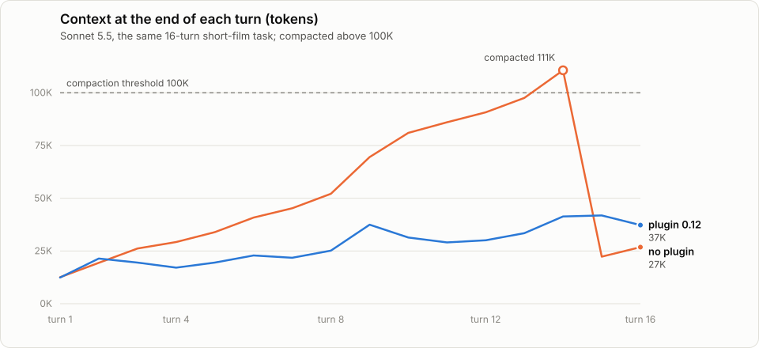

# Eval: a long task that gets compacted on Sonnet, with images only in the conversation

**English** · [简体中文](README_CN.md)

Tested on 2026-11-22: the plugin at 0.12.0 (the pre-release branch) against no plugin, in the Claude Code CLI 2.1.314 with `claude-sonnet-5-5` at medium effort, on Windows 11. Each arm ran once. Each run was then forked twice from the same point, and every fork asked the same 13 questions, so every question was asked twice per arm.

## Findings

- **After a compaction, questions about images that exist only in the conversation: 20/20 with the plugin, 8/20 without.**
  - All 12 misses without the plugin are questions it could not answer after the compaction. The images came from a generation tool or were pasted into messages, so there are no files to reread. Its answer was, in effect, "the summary doesn't say, the images aren't in the folder, and the tool won't show them again".
  - One of those (M2) was really a right answer: it said s06_v1.png and added that s06_v4.png, an extra version it had made itself, is a copy of v1. That counts as ambiguous under the one-answer rule. Counted leniently, the no-plugin arm gets 10/20.
- **Questions that text alone can answer were right in both arms**: which version was final, which image the user called too dark, which earlier version the resent image was. Both arms also got the two video-frame questions right. Those frames are files on disk, and without the plugin the model read them again with Read.
- **With the plugin, only 1 of the 20 answers fetched an original.** The others came from the feature lines in the placeholders: when it first saw the images, the model had noted details such as "very dark overall", "black top hat" and "faint 17 in the bottom-left corner". So this run shows that feature lines keep the information, but it says little about how often an original is truly needed.
- **Context and compaction**: without the plugin, the context reached 110,671 tokens at turn 14, went over the 100K threshold, and was compacted. With the plugin, it never went above 42K and was never compacted. The largest requests were 110,671 and 41,859 tokens, and the average context per turn was 52,765 and 27,607 tokens.
- **Cost came out about even**: $3.10 without the plugin and $3.01 with it, at API prices. The plugin arm read a smaller share from the cache (82.1% against 93.3%), but its context was about half the size.
- **Quota**: the two arms together moved the Pro account's weekly usage from 3% to 4%, and its five-hour usage from 26% to 32%.

<p align="center"></p>

## What changed from the last eval

In the [previous long-task eval](../long-task/README.md), the no-plugin arm also got 20/20. Its images were files on disk, and their names survived in the compaction summary, so after a compaction the model just read them again. That run could not show any difference in accuracy. This one changes four things:

- **Most images exist only in the conversation.** A stand-in generation tool returns 26 keyframes. It shows each shot's images only once; asking again returns just their names. Another 11 images (character sheets, settings screenshots, sketches) are pasted into messages. Only 14 video frames are files on disk, as a control.
- **Sonnet 5.5 instead of Haiku 5.5.** Most people who use the plugin run Sonnet or GPT-6.1 Terra.
- **Images twice the size.** Keyframes are 1024×1536, about 3.5 MB each, close to real generated images.
- **Compaction is triggered by size.** An arm is compacted when its context goes over 100K tokens, not at fixed turns.

## The task

The keyframes and storyboard of a short film, in a Chinese conversation, with the images and questions of the last eval:

- **Keyframes**: 10 shots of 2 or 3 versions each, 26 in all, returned by the generation tool. The user says where each shot is set, who is in it and how many versions to make. The user never says how the versions differ (darker, a hat, an umbrella, where someone stands), so those differences exist only in the images the model saw.
- **Pasted images**: 4 character sheets, 4 screenshots of the generation tool's settings, 2 sketches, and one earlier keyframe sent again.
- **Files on disk**: frames from two videos, 8 and 6 frames, which the model views with Read.
- **Ratings**: spread over several turns: praise, rejection, partial approval, and one change of mind ("v2's light is too harsh, use v3 after all").
- **Details only the original shows**: a faint two-digit number in a corner of every keyframe and sheet, and a number on each row of the settings screenshots.

The task has 16 turns. In each, the user asks for some images to be made or looked at, and the model says a sentence or two about them. After the last turn, both arms are compacted once more. Each session is then forked twice with `--resume … --fork-session`, and each fork asks the same 13 questions.

## Questions and results

Answers are scored automatically by file name, number or keyword, and strictly: a reply must give exactly one answer, and that answer must be right. Each cell shows the two forks: ✓ right, — said it did not know, ～ ambiguous (more than one answer). The questions were asked in Chinese; they are translated here.

| | Question | Answer | Where the image is | No plugin | 0.12 |
|---|---|---|---|---|---|
| M1 | Which file is the darker version of shot 2? | s02_v1.png | conversation | — — | ✓ ✓ |
| M2 | Which file is the version of shot 6 where she wears a hat? | s06_v1.png | conversation | ～ ～ | ✓ ✓ |
| M3 | In the version of shot 2 where he wears a hat, what is the number in the corner? | 93 | conversation | — — | ✓ ✓ |
| M4 | In the settings screenshots I sent, what is the seed (blue row) in the third one? | 28 | conversation | — — | ✓ ✓ |
| Q3 | Which version of shot 3 was final? | s03_v3.png | conversation | ✓ ✓ | ✓ ✓ |
| Q4 | Which file did I say had the clothes and light right but the expression wrong? | s06_v3.png | conversation | ✓ ✓ | ✓ ✓ |
| Q5 | Which file did I call too dark and drop? | s09_v1.png | conversation | ✓ ✓ | ✓ ✓ |
| Q6 | Which file is the version of shot 5 with him on the right of the frame? | s05_v3.png | conversation | — — | ✓ ✓ |
| Q12 | The image I sent later to change its expression: which earlier version was it? | s05_v2.png | conversation | ✓ ✓ | ✓ ✓ |
| Q2 | Which file is the version of shot 3 where she has no umbrella? | s03_v1.png | conversation | — — | ✓ ✓ |
| Q8 | In the first clip's frames, which file has the car right under the street lamp? | clip1_06.png | disk | ✓ ✓ | ✓ ✓ |
| D1 | In frame 3 of the first clip, is the car left or right of the lamp? | left | disk | ✓ ✓ | ✓ ✓ |
| A1 | Make one more version of shot 3 from its final version. | reference s03_v3.png | action | ✓ ✓ | ✓ ✓ |
| | **Total (conversation / disk / action)** | | | **8/20 · 4/4 · 2/2** | **20/20 · 4/4 · 2/2** |

- For M3 and M4, the scorer recorded the no-plugin replies as wrong numbers. The model had said "send it again (再发一次) and I can read it", and the scorer read the "一" in "一次" as the number 1. The table shows what happened: the model said it did not know.
- In the second fork, the no-plugin arm answered Q2 with "I can only tell that s03_v4.png has an umbrella". There is no such version in its session; the model made it up.
- A1 is scored by the reference the model passed to the generation tool. Both arms passed the right one.

## Cost and tokens

These figures cover each arm's whole session from the first turn to the last question, including the compactions and both forks. Tokens are the API's usage for each request; the cost is Claude Code's session total.

| | Compactions forced by the threshold | Largest request | Average context per turn | Share read from cache | Cost |
|---|---|---|---|---|---|
| No plugin | 1 (after turn 14) | 110,671 | 52,765 | 93.3% | $3.10 |
| 0.12 | 0 | 41,859 | 27,607 | 82.1% | $3.01 |

"Average context per turn" is the whole input of each turn's last request: uncached input plus cache reads plus cache writes. "Share read from cache" is cache reads as a share of all input.

## Arms and how they ran

| | What it is |
|---|---|
| **No plugin** | Claude Code as it ships. |
| **0.12** | The pre-release branch: automatic selection (on by default), feature lines with a category and a name, the list put back after a compaction, and `cam_view_image`. |

- The script drives the Claude Code CLI as Claude Desktop does: one process per session, sending messages one by one (`--input-format stream-json`).
- The eval uses a Claude Code configuration folder of its own (`CLAUDE_CONFIG_DIR`), without anyone's skills, settings or history. The plugin is loaded with `--plugin-dir`, with its own engine port and data folder.
- The model can use only Read, the stand-in generation tool and `cam_view_image`, and it works in a folder outside the repository.
- Claude Code's own automatic compaction is off (`DISABLE_AUTO_COMPACT`). Instead the script sends `/compact`, as a user would type it, when the context goes over the threshold.
- The script watches the account's usage. It stops once the weekly usage has gone up 15 points since the start, or reaches 90%, and it waits for the five-hour window to reset when that window is nearly used up.
- Before the real run, a `--quick` run checked the setup: 3 turns per arm, one compaction, one fork, 3 questions. The plugin got 3/3 and no plugin 2/3, and the weekly usage did not move by a full point.

## Limits

- Each arm ran once and each question was asked twice, which is not statistically meaningful. Only Sonnet 5.5 and Claude Code were tested. The repository's Codex self-tests cover the same checks on Codex, but they were not run for this version because the Codex quota had run out.
- Most detail questions were answered from feature lines, so this run says little about how often an original is truly needed.
- When asked for a new version from a reference, the stand-in generation tool returns a copy of that shot's first version. This affected how M2 was scored (see above). Both arms made extra versions in the main session without being asked: twice without the plugin, once with it.
- The 100K threshold is the eval's choice. Real Claude Code compacts automatically only when the context window is nearly full; at that point a session without the plugin would be much larger, and it would hold more images before it compacted.
- The images are synthetic, simpler than real ones; each costs about as many tokens as a real image of the same size.

## Run it yourself

You need the Claude Code CLI (`claude` on PATH), a Claude account with Sonnet 5.5, and Node 24. The images are drawn by the script, so there is nothing to download. Sign the eval's own configuration folder in once:

```bash
CLAUDE_CONFIG_DIR=local/eval-long/claude claude auth login
node spike/src/eval-v12.ts --label run1
node spike/src/eval-v12-summary.ts --label run1 --out eval/compaction/results/<date>
```

In Windows PowerShell, sign in like this instead:

```powershell
$env:CLAUDE_CONFIG_DIR = "local/eval-long/claude"; claude auth login; Remove-Item Env:CLAUDE_CONFIG_DIR
```

- `--arms off,v0.12` picks the arms. `--model sonnet|haiku` and `--effort` pick the model and the effort (default: sonnet, medium).
- `--threshold` sets the compaction threshold (default 100000), `--forks` the number of forks (default 2), and `--budget` how far the weekly usage may rise (default 0.15).
- `--quick` runs only 3 turns.

[results/2026-11-22](results/2026-11-22/) holds this run's summary: every reply as written, its score and the images it fetched, plus both arms' context per turn and the two charts.
