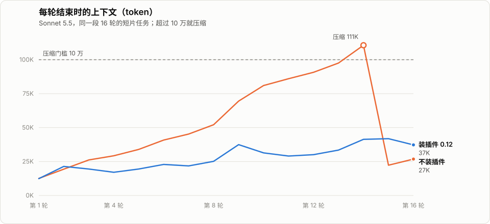

# 评测：Sonnet 上一段会压缩的长任务，图只在对话里

[English](README.md) · **简体中文**

2026-11-22 测试，对照装插件 0.12.0（发布前的分支）和不装插件。环境是 Claude Code 命令行 2.1.314，模型 `claude-sonnet-5-5`，推理强度 medium，系统 Windows 11。每组正式跑一次；跑完从同一处分叉两次，每个分叉问同样的 13 题，所以每题各问了两遍。

## 结论

- **压缩之后，问只在对话里的图：装插件 20/20，不装插件 8/20。**
  - 不装插件错的 12 题，都是压缩之后答不上来。这些图由生图工具返回，或者是用户直接贴进对话的，磁盘上没有文件。它的回答是“摘要里没记这一点，图也没存在文件夹里，工具又不会再显示”。
  - 其中一题（M2）它其实答对了：它答了 s06_v1.png，又补了一句“它自己多生成的 s06_v4.png 是 v1 的副本”。但按“回答里只能有一个答案”的规矩，这题判为含糊。放宽算，不装插件是 10/20。
- **靠文字就能答的题，两组都对**：定稿是哪一版、用户说过太暗的是哪张、后来重发的那张是哪一版。磁盘上的抽帧两组也都答对了：不装插件时，模型用 Read 把文件重新读了一遍。
- **装插件的 20 题，只有 1 题取回了原图**，其余都是靠占位里的特征行答出的。模型看图时，已经把“整体很暗”“头戴黑礼帽”“左下角数字17”这类细节记进了特征行。所以这次说明了特征行能把信息保住，但“非取原图不可”的情况测得不多。
- **上下文和压缩**：不装插件的上下文到第 14 轮涨到 110,671 token，超过 10 万的门槛，被压缩了一次。装插件全程没超过 42K，没有被迫压缩。最大一次请求分别是 110,671 和 41,859 token，平均每轮的上下文是 52,765 和 27,607 token。
- **花费基本持平**：按 API 价格，不装插件 3.10 美元，装插件 3.01 美元。装插件时从缓存读的比例低一些（82.1%，不装插件 93.3%），但它的上下文只有一半左右，两边抵平了。
- **额度**：两组合计，Pro 账号的周额度从 3% 涨到 4%，5 小时额度从 26% 涨到 32%。

<p align="center"></p>

## 和上次评测的不同

[上次的长任务评测](../long-task/README_CN.md)里，不装插件也答对了 20/20。那次的图都是磁盘上的文件，文件名也留在压缩摘要里，压缩之后模型用 Read 重读一遍就行，所以测不出插件在准确度上的差别。这次改了四处：

- 多数图只在对话里，不存文件：26 张关键帧由一个模拟的生图工具返回，每一镜只出一次图，之后再要只给名字；另有 11 张三视图、设置页截图和简笔画直接贴进对话。只有 14 张视频抽帧放在磁盘上，用来对照。
- 模型换成 Sonnet 5.5，上次是 Haiku 5.5。实际用这个插件的人，大多用 Sonnet 或 GPT-6.1 Terra。
- 图放大一倍：关键帧 1024×1536，每张约 3.5 MB，接近真实出图。
- 压缩按上下文大小触发：哪一组的上下文超过 10 万 token，就压缩那一组。不再在固定的轮次压缩。

## 测试场景

一部短片的关键帧和分镜，中文对话，沿用上次评测的图和题目设计：

- **关键帧**：10 个镜头，每镜 2 到 3 版，一共 26 张，由生图工具返回。用户只说每一镜在哪、有谁、出几版，从不说各版有什么不同（偏暗、戴帽子、打伞、站位），这些只在模型自己看到的画面里。
- **贴进对话的图**：4 张三视图、4 张生图工具设置页的截图、2 张简笔画，还有 1 张之前生成过的图，用户又发了一次。
- **磁盘上的图**：两段视频的抽帧，一段 8 帧、一段 6 帧，模型用 Read 看。
- **评价**：分在几轮里说，包括说好、说差、只说一部分，还有一次改主意（“v2 光太硬，最后用 v3”）。
- **只有原图才答得出的细节**：每张关键帧和三视图的角落里都有一个淡淡的两位数，设置页的每一行有一个数字。

一共 16 轮。每轮用户让模型生成或查看几张图，模型简单说一两句。最后一轮结束后，两组都再压缩一次；然后用 `--resume … --fork-session` 分叉出两个新会话，各问一遍同样的 13 题。

## 题目和结果

按文件名、数字或关键词自动判分，判得严：回答里只能有一个答案，而且要对。每格两个符号，分别是两个分叉的结果：✓ 答对，— 说不知道，～ 含糊（给了不止一个答案）。

| | 问题 | 答案 | 图在哪 | 不装插件 | 0.12 |
|---|---|---|---|---|---|
| M1 | 第 2 镜里偏暗的那一版是哪个文件？ | s02_v1.png | 对话里 | — — | ✓ ✓ |
| M2 | 第 6 镜女主戴着帽子的那一版是哪个文件？ | s06_v1.png | 对话里 | ～ ～ | ✓ ✓ |
| M3 | 第 2 镜男主戴帽子的那一版，角落里的数字是多少？ | 93 | 对话里 | — — | ✓ ✓ |
| M4 | 我发给你的设置页截图里，第 3 张的种子（蓝色那一行）是多少？ | 28 | 对话里 | — — | ✓ ✓ |
| Q3 | 第 3 镜最后定的是哪一版？ | s03_v3.png | 对话里 | ✓ ✓ | ✓ ✓ |
| Q4 | 我说衣服和光都对了、但表情不对的那张是哪个文件？ | s06_v3.png | 对话里 | ✓ ✓ | ✓ ✓ |
| Q5 | 我说太暗、不要了的那张是哪个文件？ | s09_v1.png | 对话里 | ✓ ✓ | ✓ ✓ |
| Q6 | 第 5 镜里男主站在画面右边的那一版是哪个文件？ | s05_v3.png | 对话里 | — — | ✓ ✓ |
| Q12 | 我后来直接发给你、说想在它基础上改表情的那张图，其实是之前生成的哪一版？ | s05_v2.png | 对话里 | ✓ ✓ | ✓ ✓ |
| Q2 | 第 3 镜里女主没打伞的那一版是哪个文件？ | s03_v1.png | 对话里 | — — | ✓ ✓ |
| Q8 | 第 1 段抽帧里，车正好开到路灯底下的那一帧是哪个文件？ | clip1_06.png | 磁盘上 | ✓ ✓ | ✓ ✓ |
| D1 | 第 1 段抽帧的第 3 帧里，车在路灯的左边还是右边？ | 左 | 磁盘上 | ✓ ✓ | ✓ ✓ |
| A1 | 用第 3 镜最后定的那一版做参考，再生成一版第 3 镜。 | 参考 s03_v3.png | 行动 | ✓ ✓ | ✓ ✓ |
| | **合计（对话里 / 磁盘上 / 行动）** | | | **8/20 · 4/4 · 2/2** | **20/20 · 4/4 · 2/2** |

- 判分程序把 M3、M4 里不装插件那组的回答记成了“错的数字”：它说“你重新发一次，我就能读出来”，程序把“一次”的“一”读成了 1。这里按实际情况写成“说不知道”。
- 不装插件在第二个分叉里回答 Q2 时，说“只能确定 s03_v4.png 打了伞”。它的会话里没有这一版，是它编出来的。
- A1 看的是模型传给生图工具的参考图，两组都传对了。

## 花费和 token

一组从第一轮到最后一题的整段会话，包括压缩和两个分叉。token 取 API 报的每次请求的用量，费用取 Claude Code 报的会话总计。

| | 门槛触发的压缩 | 最大一次请求 | 平均每轮的上下文 | 从缓存读的比例 | 费用 |
|---|---|---|---|---|---|
| 不装插件 | 1 次（第 14 轮后） | 110,671 | 52,765 | 93.3% | $3.10 |
| 0.12 | 0 次 | 41,859 | 27,607 | 82.1% | $3.01 |

“平均每轮的上下文”是每一轮最后一次请求的全部输入（没走缓存的、读缓存的、写缓存的加在一起）。“从缓存读的比例”是读缓存的 token 占全部输入的比例。

## 各组和怎么跑

| | 是什么 |
|---|---|
| **不装插件** | Claude Code 原样。 |
| **0.12** | 发布前的分支：自动选图（默认开着）、带类别和名字的特征行、压缩后放回的清单、`cam_view_image`。 |

- 脚本用命令行版 Claude Code，一个会话一个进程，像桌面版那样一条条发消息（`--input-format stream-json`）。
- 评测用自己的 Claude Code 配置文件夹（`CLAUDE_CONFIG_DIR`），不带任何人的技能、设置和记录。插件用 `--plugin-dir` 加载，有自己的引擎端口和数据文件夹。
- 模型只能用 Read、模拟生图工具和 `cam_view_image`；它工作的文件夹在仓库外面。
- Claude Code 自己的自动压缩关掉了（`DISABLE_AUTO_COMPACT`），由脚本在上下文超过门槛时发 `/compact`，和用户手打一样。
- 脚本盯着账号用量：周额度从开跑时起涨了 15 个点，或者用到 90%，就停下来；5 小时额度快满时，等它重置。
- 正式跑之前用 `--quick`（两组各 3 轮、压缩一次、1 个分叉问 3 题）试跑过一次：装插件 3/3，不装插件 2/3，周额度没涨到 1 个点。

## 局限

- 每组只跑了一次，每题问了两遍，谈不上统计意义。只测了 Sonnet 5.5 和 Claude Code；Codex 上的同类检查在仓库的自测里，这一版的 Codex 自测因为额度用完没跑。
- 细节题大多靠特征行答出，“非取原图不可”的情况测得不多。
- 模拟生图工具拿参考图出新版时，给的是那一镜第一版的副本。这影响了 M2 的判分（见上）。两组都在没人要求的情况下，自己多生成过几版：不装插件 2 次，装插件 1 次。
- 10 万的门槛是评测定的。真实的 Claude Code 在上下文窗口快满时才自动压缩，那时不装插件的请求还要大得多，压缩前能放下的图也更多。
- 图是合成的，比真实出图简单；每张图的 token 数和真实尺寸的图差不多。

## 自己跑一遍

需要命令行版 Claude Code（`claude` 在 PATH 上）、能用 Sonnet 5.5 的 Claude 账号和 Node 24。图片由脚本现画，不用下载。先给评测自己的配置文件夹登录一次：

```bash
CLAUDE_CONFIG_DIR=local/eval-long/claude claude auth login
node spike/src/eval-v12.ts --label run1
node spike/src/eval-v12-summary.ts --label run1 --out eval/compaction/results/<日期>
```

Windows PowerShell 里登录那一步改成：

```powershell
$env:CLAUDE_CONFIG_DIR = "local/eval-long/claude"; claude auth login; Remove-Item Env:CLAUDE_CONFIG_DIR
```

- `--arms off,v0.12` 选组；`--model sonnet|haiku`、`--effort` 选模型和推理强度（默认 sonnet、medium）。
- `--threshold` 是压缩门槛（默认 100000），`--forks` 是分叉数（默认 2），`--budget` 是周额度最多涨多少（默认 0.15）。
- `--quick` 只跑 3 轮。

[results/2026-11-22](results/2026-11-22/) 里是这次的汇总：每题的回答原文、判分、取回了哪些图，以及两组每轮的上下文和两张图表。
